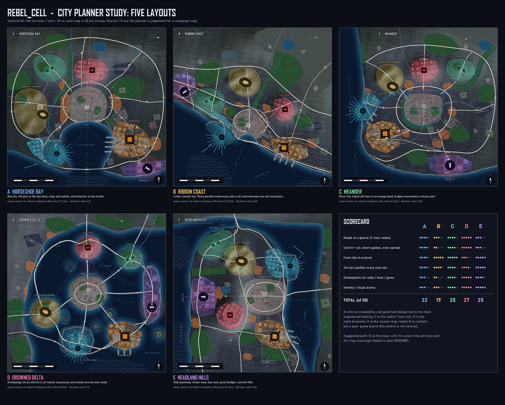

# City planner study: five layouts for the REBEL_CELL city

An independent plan, drawn from the brief only (no existing city layout, zoning files or game code was opened). Corp flavour came from the corp names and the identity notes for Tethys and Aurelian.

## What is here
| Design | Idea | Plan (map + legend) | Write-up |
|---|---|---|---|
| A | Horseshoe Bay: old port at a bay head, rings and radials, storm barrier | `plan_A_horseshoe_bay.png` | `design_A_horseshoe_bay.md` |
| B | Ribbon Coast: linear city between sea and mountains, three parallel motorways | `plan_B_ribbon_coast.png` | `design_B_ribbon_coast.md` |
| C | Meander: island old town in a river bend, bridges, estuary port | `plan_C_river_meander.png` | `design_C_river_meander.md` |
| D | Drowned Delta: seven islands in a flooded lagoon, causeways and tunnels | `plan_D_delta_archipelago.png` | `design_D_delta_archipelago.md` |
| E | Headland Hills: hilly peninsula, ocean west, bay east, great bridges | `plan_E_headland_hills.png` | `design_E_headland_hills.md` |

`map_*.png` are the bare 2000 px maps; `plan_*.png` add the legend, per-design district notes and the "how the city grew" timeline. `comparison.png` has all five plus a scorecard.

## Shared brief coverage (all five)
- **Seven districts**: Old City at the centre, six corps around it, each with its landmark (Panopticon pyramid, twin-helix tower, launch ring and rocket, gantry-crane castle, Circus Aurelius, floating pier city).
- **Ocean border** with a port, a drowned quarter and dams for Tethys, sea walls, a storm barrier or surge gates.
- **Highways**: ring(s), radials, freight expressways, stack interchanges with ramps (auto-placed at motorway crossings), bridges and tunnels.
- **Rail**: freight to Meridian and the port, commuter lines into an old-city terminus, metro with underground sections, stations and multimodal hubs.
- **City pieces**: stadium, airport, spaceport and exclusion zone, universities, hospitals, neon markets, power, water, sewage, recycling, cemeteries, data centres, parks, plazas.
- **Cyberpunk layer**: arcologies, megastructures, corp walls with checkpoints at every road crossing, slums and stacked housing, undercity, drone corridors, sea walls, ferries, offshore wind.
- **Planning logic**: land value on high ground and waterfront; industry and port downwind and on rail (wind arrow on each map); slums by highways and rail yards; street pattern changes by era (organic core, rail grid, curvilinear suburb, corp superblocks, planned radial, informal).

## Numbers (centre to each corp, from the maps)
| | mean | farthest : nearest |
|---|---|---|
| A Horseshoe Bay | 7.4 km | 2.4 |
| B Ribbon Coast | 5.9 km | 2.6 |
| C Meander | 6.3 km | 1.6 |
| D Drowned Delta | 6.6 km | 1.4 |
| E Headland Hills | 6.1 km | 2.0 |

Lower far:near means the six corps sit at more even distances from the Rebel Cell, which suits a campaign map where every corp should be a comparable move away.

## Recommendation
**Pick D (Drowned Delta) as the base, and fold in two things from the others.**

Why D:
1. **It wins the glance test.** Seven islands are seven nodes with a clear silhouette each. A player can name the whole map after one look, even with the legend off.
2. **Best centre-and-six geometry** (far:near 1.4), so no corp is a trivial or an impossible move.
3. **Chokepoints are built in.** Bridges, causeways and tunnels give natural raid routes, checkpoints, Heat zones and defence choices; Halcyon's surveillance and Tethys's water story both get a physical shape.
4. **Every brief item still fits**: a drowned quarter and dams are the premise, not an add-on, and the sea-level-rise history explains why the districts are islands.

What to borrow:
- From **C**: the canal-ring old town (canals as streets in the flooded lower town is already half there) and the river-and-bridge texture for the mainland margin, so the centre feels less diagrammatic.
- From **A**: its ring logic. R1 and the Lagoon Ring already echo it, but A's R2 closing across a barrier is a good model for the surge-barrier gates.

Fallback: **C** if the designer wants a layout that feels like a grown city rather than a game board (best "real" score, 1.6 spoke ratio). **E** is the one to pick if drama and terrain identity matter most and a portrait map is acceptable.

D weaknesses to fix in iteration: islands are rounded blobs and need more shoreline character and reclaimed edges; the mainland is mostly empty; the road map is bridge-heavy and should show which links are tunnels; undercity should connect islands under the lagoon.

## Method notes and assumptions
- Scale: 1 map unit = 20 m, each map is 20 km across (scale bar and 5 km grid ticks on every map). Street texture is schematic: spacing is drawn about double the real block size so it stays legible at 2000 px.
- Prevailing wind: from the west in A, B, D and E; from the NE in C (shown by an arrow on each map). Industry, port and slums sit downwind.
- Place names (Veyra estuary, Foundry Row, etc.) are placeholders for the map only.
- Orbital sits where launches can go over open water; Meridian where deep water, rail and trucks meet; Tethys on the lowest, flood-prone shore; Halcyon on the highest ground or a hill island that sees the core; Solace on clean, upwind, upstream ground; Aurelian on river hills.
- Not committed. Everything here is concept art for the designer to choose from.

## Regenerate
CPU only, Python with Pillow and numpy:
`python scripts/run_design.py a` (also b, c, d, e) then `python scripts/metrics.py` and `python scripts/compare.py`. Each design is one script (`scripts/design_*.py`) over the shared kit (`geom.py`, `canvas.py`, `citymap.py`, `panel.py`, `common.py`).
