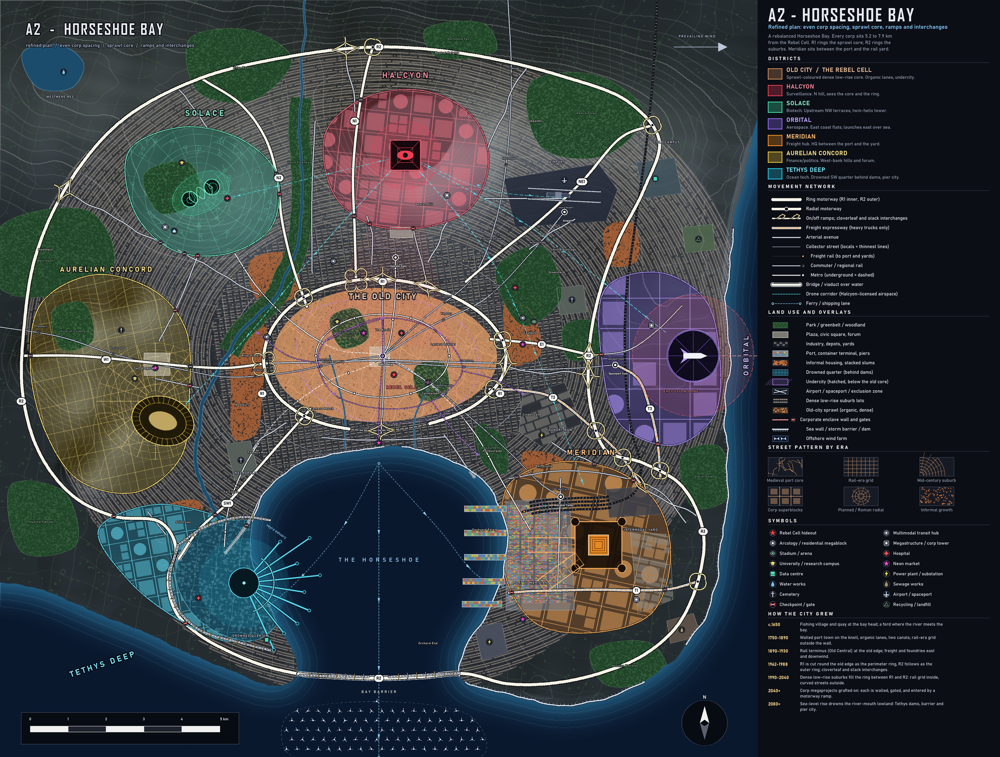

# A2 - HORSESHOE BAY (refined)

Refinement of design A after the designer's pick. Same bay-city concept, rebalanced and detailed. Machine-readable export: `city_A2.json`. Generator: `scripts/run_a2.py` (kit: `citymap2.py`, `design_a2.py`).

## What changed from A, and why
| A weakness | A2 fix |
|---|---|
| Corp distances 4.4 to 10.6 km, far:near 2.4 (Orbital far SE, Halcyon too close) | Corps now sit 5.2 to 7.9 km from the Rebel Cell, **far:near 1.52**. Halcyon pushed 1 km north; Orbital moved to the **east coast flats** (open sea launch, still outside R2); Tethys and Aurelian pulled in; the old-city centre moved up so the bay is not "in" the ring. |
| Old city read as pale civic grey | The core is **sprawl-coloured** (warm tan, dense organic lanes and tiny lots, undercity network). It is the only warm block on the map, so the Rebel Cell hides in it. |
| R1 sat a little off the core edge | R1 is a smooth ellipse hugging the core edge (perimeter ring, tunnelled on the waterfront), with the sprawl core inside and suburbs outside. |
| Interchanges were symbols, no real ramps | Real ramp geometry: **2 cloverleafs** (R1 at N1 and W1), **10 stacks** (ring and radial crossings), **9 diamond interchanges** with slip ramps where arterials meet R1 or R2. Ramps taper off tangent to the mainline. |
| HQ clearance not checked | Script check: no motorway or rail comes within 1.2 km of any HQ (Meridian excepted, see below). |
| Meridian: yards and road ended at the castle | Meridian HQ is **between the port (west) and the rail yard (east)**. Freight main runs along the castle's north side, T1 port expressway along its south side, both continuing past it. No road or rail ends at the HQ. Freight rail ends at the **Port of Meridian** container terminal (5 piers, 80 x 130 unit yard), in Meridian territory, nowhere near Tethys. |
| Tethys port overlap in the SW | Tethys now owns only the **drowned quarter behind two dams** (north and west) and the floating pier city; no freight, no container port. |
| Some bends were sharp | Rings are closed splines, all other roads and rails pass a script check (no turn over 48 degrees in a 480 m window). District outlines are smooth too. |
| Suburbs were sparse texture | Dense low-rise: rail-era grid with two rows of lots per block inside, elliptical curved streets with lots on both sides outside. Parks break it up. |
| Light micro-planning | 26 named neighbourhoods, 15 named parks, 6 markets, 45 named stations, 7 named undercity entrances, 24 checkpoints, 18 named streets, three-tier street hierarchy. |

## Layout
- **Old City / Rebel Cell:** centre at the bay head. Founders Row, The Knoll, Saltmarket, Old Port, Tanners Reach, Lantern Quarter. Undercity: ring tunnel plus four spokes, entrances Port Gate, Flats Stair, Foundry Shaft, Bayshore Lift, Knoll Well, Tanners Sink, Lantern Hatch.
- **Perimeter ring R1** around the core; **R2** around the suburbs, closing over the Bay Barrier causeway (two leaves with a ship-lock gap).
- **Corps (centroid distance):** Halcyon N hill 5.2 km; Solace NW terraces 6.5 km; Aurelian W river hills 7.2 km; Orbital E coast 7.3 km; Meridian SE bay shore 7.4 km; Tethys SW drowned quarter 7.9 km.
- **Meridian freight hub:** Intermodal yard (NE of HQ) feeds the Freight Main along the HQ's north flank to the port terminal; T1 along the south flank to the port gate; T2 Foundry Link to R1; T3 Rocket Road to Orbital's gate. HQ cranes reach the quay.
- **Orbital:** launch ring on the east shore, azimuth 90 degrees (east), 1.6 km exclusion zone half over water. Spaceport Gate station on the C5 line, T3 for stages.
- **Street hierarchy:** motorway (ring, radial, truck) > arterial (hand-named avenues plus 14 radial avenues) > collector (4 elliptical collector rings) > local (thin lines, lots).
- **Transit:** 5 commuter lines into Old Central, 3 metros plus the M1 loop (underground sections dashed), 5 hubs (Old Central, Meridian Yards, Airport, Halcyon Gate, Spaceport Gate), freight terminals at the yard and the port.
- **Corp walls:** each of the six has a wall; every road crossing has a checkpoint (24 in total).

## Checks run by the script
- Corp distance far:near **1.52** (target 1.6).
- Nearest motorway-class road to HQs: Halcyon 1.35 km, Solace 2.06, Orbital 1.56, Meridian 1.18 (alongside by design), Aurelian 1.50, Tethys 1.79. Meridian freight main ends 2.2 km from the HQ, in the port.
- Sharp turns over 48 degrees in 480 m: none.

## city_A2.json (for the Blender build)
- **Unit: metre.** **Origin: the map centre**, i.e. planning-grid point (500, 500) is (0, 0). **Axes: +X east, +Y north, +Z up.** All x,y pairs are `[x_m, y_m]`. Extent is -10000 to +10000 m on both axes (20 km square). Planning grid to metres: `x_m = (x - 500) * 20`, `y_m = (500 - y) * 20` (the maps were drawn on a 1000 x 1000 grid, 1 unit = 20 m).
- Sea level is 0 m. Hills are Gaussians (`terrain.hills`: centre, sigma_x/y in metres, `height_m` = h x 260, rotation in radians); the coast is the 0 m contour.
- Bearings are compass degrees clockwise from north.
- Top-level keys: `meta`, `terrain` (coastline polyline, ocean polygon, rivers and canals with widths, lakes, hills), `defences` (dams, barrier leaves, sea walls), `drowned_quarter` (polygon, dams it sits behind, pier city centre and radius), `districts` (id, name, colour, polygon, centre, area, HQ and position, wall polyline, gate positions, distance from the old city), `neighbourhoods`, `landmarks` (HQs, hospitals, universities, markets, power, water, arcologies, megastructures, and so on), `roads` (class, width, polyline, tunnel and bridge sub-polylines), `interchanges` (type, position, roads, ramp polylines), `rails` (kind, gauge, polyline, tunnel parts), `stations` (name, kind, position, lines), `port` (terminal polygon, piers with bearing and length, rail terminus, truck gate, intermodal yard), `parks`, `plazas`, `cemeteries`, `markets`, `industry`, `informal_housing`, `airport`, `spaceport`, `undercity` (polygon, tunnels, entrances), `checkpoints`, `ferries`, `drone_corridors`.
- Polylines are open unless `closed` is true (last point equals first). Roads and rails are sampled every 80 m, ramps every 40 m. Run `python scripts/verify_a2.py` for a quick sanity check of the file.
- Not in the file: building footprints and street-level lots (generate them in Blender from the district and neighbourhood polygons and the road classes), and terrain noise.

## Gameplay readability
- **Better than A:** all six corps are a comparable distance away; the sprawl core is the one warm shape on the map; a clean perimeter ring marks "inside" and "outside"; Meridian reads as the freight hub (port, HQ, yard in a row); Tethys is unmistakably water.
- **Still weak:** the bay still takes the lower third of the map; suburbs are dense texture, so the game layer will need its own node overlay (the JSON has the neighbourhoods and stations to build it from).
