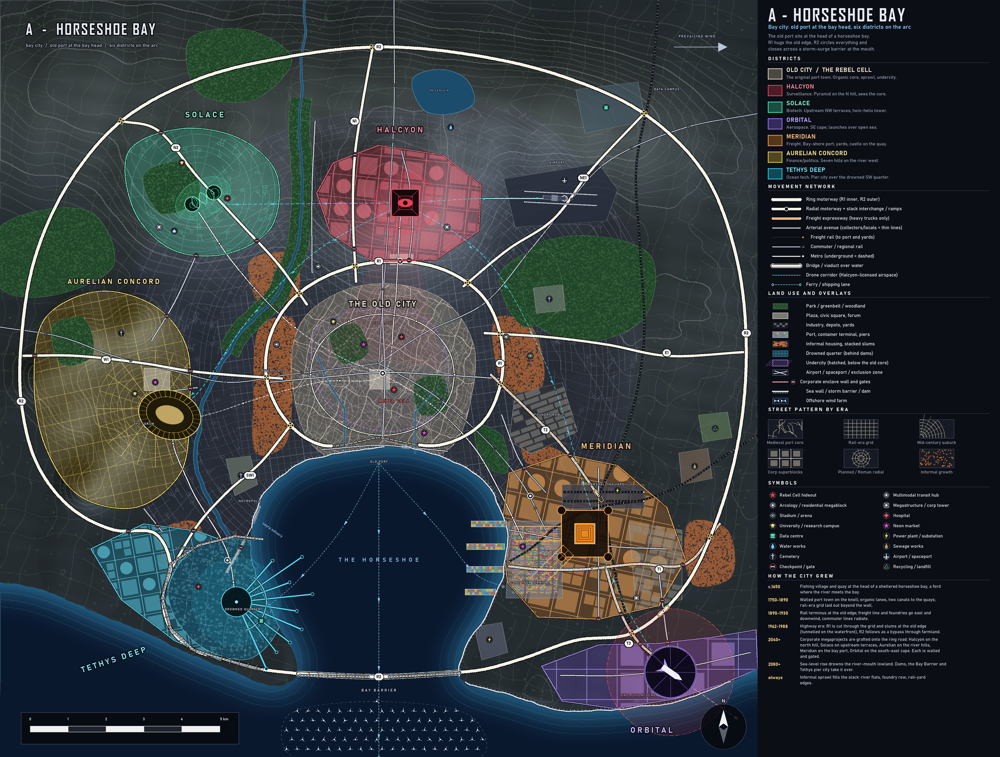

# A - HORSESHOE BAY (bay city)

**Concept.** A near-closed bay with a 4 km mouth. The old port sits at the bay head, a river enters on the west shore, and the six corps are strung on a 270-degree arc around the old core. Two rings and six radials make a classic hub-and-ring graph; the bay gives the map one unmistakable "front".

**Terrain.** North hill (highest), NW terraces, seven low hills on the west bank, a river from the northern ridge to the west bay shore, a flat south-east cape facing open sea. Prevailing wind from the west.

## How it evolved
- **c.1650** Fishing village and quay at the bay head, ford at the river mouth.
- **1750-1890** Walled port town on the knoll: organic lanes, two canals to the quays. Rail-era grid beyond the wall.
- **1890-1930** Rail terminus at the old edge. Freight line, yards and foundries go east and downwind.
- **1962-1988** R1 is cut through grid and slums at the old edge (tunnel on the waterfront). R2 follows as a bypass through farmland and closes over a causeway.
- **2040+** Corp megaprojects are grafted onto the ring road, each walled and gated where a motorway enters.
- **2080+** The river-mouth lowland drowns; dams, the Bay Barrier and a pier city.
- **Always** Informal sprawl in the slack: river flats, foundry row, rail-yard edges.

## Why each district is where it is
| District | Site | Logic |
|---|---|---|
| Old City | Bay head knoll | First port and ford; canals; organic core with undercity |
| Halcyon | North hill, 4.4 km out | Highest ground, line of sight to the core; pyramid cone and drone corridors fan out |
| Solace | NW terraces | Upstream and upwind (clean water, sea breeze), next to the university belt |
| Aurelian | West bank "seven hills" | River forum, Circus Aurelius on the flats, Via Aurelia as the axis |
| Tethys | SW river mouth | Lowest land, first flooded; dams + pier city over the drowned quarter, cable landing nearby |
| Meridian | East bay shore | Deep water and rail from the east; yards, trucks T1-T3, industry downwind |
| Orbital | SE cape | Flat open land at the edge, launches SE over sea, exclusion zone half over water; Launch Road to the port for stages |

## Key planning moves
- **Rings:** R1 (old edge, tunnelled on the waterfront), R2 (outer, closes on the Bay Barrier causeway with a ship-lock gap).
- **Radials:** N1 Halcyon, N2 Solace, W1 Via Aurelia, SW1 Tethys Link, NE1 Airport, E1 Coastal; freight expressways T1-T3 for Meridian and Orbital. Stack interchanges where motorway classes cross.
- **Rail:** freight east main to the yards and port, north belt, Orbital spur; four commuter lines into Old Central; three metro lines plus an inner loop.
- **Land use:** industry east (downwind), parks as river and wedge greenbelts, slums beside R1, rail yards and the river flats, airport NE, power and sewage SE, cemeteries by the river and NE.
- **Blocks by era:** organic core, rail-era grid, curvilinear suburbs between the rings, superblocks inside corp walls, radial Roman fabric in Aurelian.

## Gameplay readability
- **Good:** one hub with a clean ring, every corp one radial away; the bay gives a clear orientation; Tethys and Meridian read instantly by the water; ring roads are natural Heat zones.
- **Weak:** reads as a standard ring-radial; a third of the canvas is bay or empty hinterland; Orbital is the far outlier (ratio far:near 2.4); the west side (Aurelian, Solace) is crowded against the highway ring.
