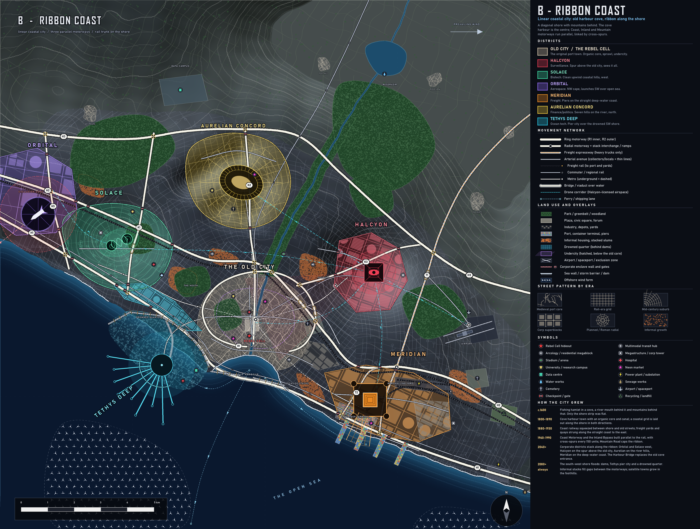

# B - RIBBON COAST (linear coastal city)

**Concept.** A diagonal shore with mountains behind: the city is a 15 km ribbon squeezed between sea and range. A small cove is the old harbour; three parallel motorways (Coast, Inland Bypass, Mountain Road) and a rail trunk run the full length, linked by cross-spurs. This is how most real coastal megacities grow.

**Terrain.** Mountain wall to the NE, a river down to the cove head, a straight deep-water coast to the SE, a low drowned-prone shore to the SW. Prevailing wind from the west.

## How it evolved
- **c.1600** Fishing hamlet in a cove, river mouth behind; only the shore strip is flat.
- **1800-1890** Cove harbour town with organic core and a canal; coastal grid laid out along the shore both ways.
- **1880-1930** Coast railway squeezed between shore and old streets; yards and quays strung along the straight coast east.
- **1960-1990** Coast Motorway and Inland Bypass built parallel to the rail with cross-spurs; Mountain Road caps the ribbon.
- **2040+** Corps stack along the ribbon. A Harbour Bridge replaces the cove entrance, pushing deep-draught ships to Meridian.
- **2080+** The SW shore floods: dams, pier city, drowned quarter.
- **Always** Informal stacks fill the gaps between motorways; foothill towns grow.

## Why each district is where it is
| District | Site | Logic |
|---|---|---|
| Old City | Cove harbour | Natural shelter and river mouth; undercity under the core |
| Halcyon | Spur above the old city (NE) | Overlooks the cove and the bridge, 4.7 km out |
| Solace | West coastal hills | Clean upwind air, sea view, far from the freight line |
| Orbital | NW end of the ribbon | Flat open cape, launches SW over open sea; stages come by the Orbital freight line along the bypass |
| Meridian | SE straight coast | Deep water, pier comb, freight from the east, trucks T1/T2, industry downwind |
| Aurelian | River hills north | Seven hills and a river forum under the mountains |
| Tethys | SW low shore | Lowest ground; drowned quarter behind dams and a pier city |

## Key planning moves
- **Highways:** H1 coast, H2 inland bypass (also the freight corridor), H3 mountain road; R1 around the old core; spurs K1-K5 and truck roads T1/T2. Stack interchanges where they cross.
- **Rail:** coast commuter line, orbital freight line along H2, valley and east commuter lines; metro under the old city.
- **Land use:** industry SE and east, wealth on the hill spur and facing the sea, slums by the bypass and yards, airport inland east.
- **Blocks by era:** tight organic cove, tilted coastal grid, large superblocks for the corps, curvilinear foothill suburbs.

## Gameplay readability
- **Good:** most believable layout; strong infrastructure story (parallel roads, long freight line); terrain is legible (sea left, mountain right).
- **Weak:** the old city is not central, so "six around one" is stretched (far:near 2.6); diagonal format wastes two corners; a line has few chokepoints; raids come from one side only.
