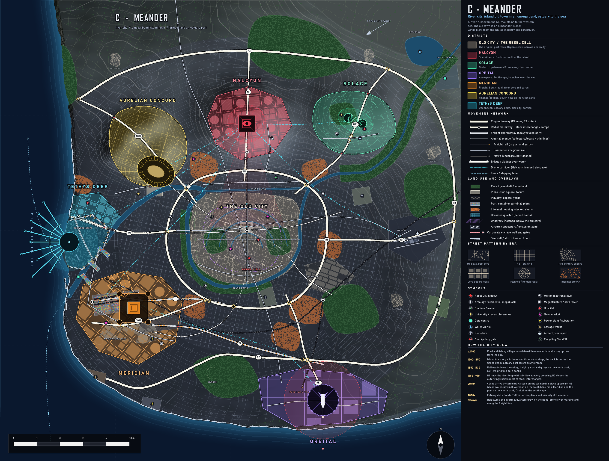

# C - MEANDER (river city)

**Concept.** A river from the NE mountains wraps the old town in an omega bend (a meander island, neck cut by a Grand Canal) and runs out to the sea in a west-facing estuary. Winds blow from the NE, so clean land is upstream and upwind, industry and port are downriver. Bridges are the signature element.

**Terrain.** Mountains NE, a tor north of the island, seven hills on the west bank, a flat south cape on the coast, an estuary delta on the west. Prevailing wind from the NE.

## How it evolved
- **c.1400** Ford and fishing village on a defensible meander island.
- **1500-1850** Island town: organic lanes, three canal rings, neck canal. Estuary port grows downstream.
- **1850-1930** Railway follows the valley; yards and quays on the south bank; grid fills both banks.
- **1960-1990** R1 rings the river loop with a bridge at every crossing; R2 closes the outer ring; radials with stack interchanges.
- **2040+** Corps arrive by corridor and take the best site for each trade.
- **2080+** The estuary delta floods: Tethys barrier, dams, pier city.
- **Always** Rail slums and informal quarters on the flood-prone margins and along the freight line.

## Why each district is where it is
| District | Site | Logic |
|---|---|---|
| Old City | Meander island | Defensible ford, canals, organic core and undercity |
| Halcyon | Tor north of the island | High rock, 4.9 km, looks down on the island and its canal bridges |
| Solace | Upstream NE terraces | Clean water, upwind, away from the port |
| Aurelian | West-bank hills | Seven hills, forum and Circus on the river bank |
| Tethys | Estuary delta (west) | Lowest land, first to flood; estuary barrier and pier city |
| Meridian | South-bank river port | Quays, rail down the valley, yards, trucks; downwind SW |
| Orbital | South cape | Open flats at the edge, launches south over the sea; T2 "rocket freight" from Meridian |

## Key planning moves
- **Rings:** R1 around the river loop (two bridges plus the south crossing), R2 outer ring (C-shaped, ends on the coast).
- **Radials:** N1 Halcyon, NW1 Aurelian Way, NE1 Solace Parkway, E1 airport, SE1 Orbital, SW1 port expressway, W1 delta link; trucks T1/T2.
- **Rail:** valley freight main along the south bank, Orbital branch, four commuter lines to the island terminus, three metros.
- **Land use:** floodplain parks along the river, industry and gasworks SE and SW, slums at the rail line, airport east, power and sewage downstream.
- **Blocks by era:** canal-ring organic old town, rail-era grid, curvilinear suburbs, superblocks in corps.

## Gameplay readability
- **Good:** the island is a memorable hub; best balance of spoke lengths among the "real" layouts (far:near 1.6); many bridges and gates make natural raid chokepoints.
- **Weak:** the river competes with the road rings visually; the sea is a thin strip on the west so Tethys sits at the map edge; the island may be small for a sprawling centre (the sprawl is on the banks instead).
