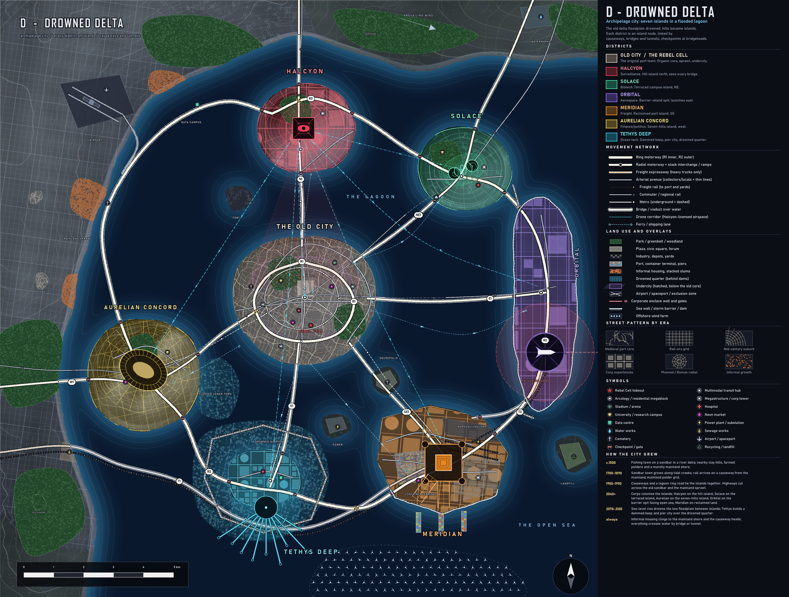

# D - DROWNED DELTA (archipelago city)

**Concept.** A river-delta floodplain that the sea took back. The hills and levees became islands; each corp took one; the old sandbar town is the central island. Everything is linked by causeways, bridges and tunnels, so the road map is literally a hub-and-spoke graph with a ring. A mainland (west and north) carries airport, sprawl and the rail and road entries.

**Terrain.** A shallow lagoon with seven islands, a marshy mainland shore, open sea to the east and south. Prevailing wind from the west.

## How it evolved
- **c.1500** Fishing town on a sandbar in a delta; clay hills, polders, marsh.
- **1700-1890** Sandbar town grows along tidal creeks; the railway arrives by causeway.
- **1950-1990** Causeways and a lagoon ring road tie the islands together; highways slice the old sandbar and mainland sprawl.
- **2040+** Corps colonise the islands: Halcyon on the hill island, Solace on the terraced island, Aurelian on the seven-hills island, Orbital on the barrier spit, Meridian on reclaimed land.
- **2070-2100** Sea-level rise drowns the low floodplain between islands. Tethys builds a dammed keep and pier city over the drowned quarter.
- **Always** Informal housing at the mainland shore and the causeway heads.

## Why each district is where it is
| District | Site | Logic |
|---|---|---|
| Old City | Central sandbar island | First port, organic core, canals as streets in the flooded lower town, undercity |
| Halcyon | Hill island (north) | Highest ground, watches every bridge; drone corridors cross the lagoon |
| Solace | Terraced island (NE) | Isolated campus, clean sea air, one controlled bridge |
| Aurelian | Seven-hills island (west) | Hills and radial fabric; Circus Aurelius; the mainland gateway |
| Tethys | Dammed keep (south) | Lowest land, ring dam, pier city fanning into open sea over the drowned quarter |
| Meridian | Reclaimed port island (SE) | Deep water, rectilinear reclaimed grid, freight viaduct and yards |
| Orbital | Barrier-island spit (east) | Open sea to the east, launch ring with exclusion zone over water |

## Key planning moves
- **Rings and radials:** R1 around the central island; R2 "Lagoon Ring" hops island to island; six radial causeways (N1, NE1, E1, SE1, S1, W1); freight viaduct T1 along the south.
- **Rail:** south freight main to Meridian then Orbital branch; four commuter lines (several partly in tunnels under the lagoon); three metro lines.
- **Defence:** surge barriers at the lagoon gaps, ring dam round Tethys, sea walls on the open-sea coasts of Orbital and Meridian, checkpoints at every bridgehead.
- **Blocks by era:** organic core, rail-era grid on the mainland, curvilinear Solace, radial Aurelian and Halcyon, superblocks on reclaimed land, a long linear spit for Orbital.

## Gameplay readability
- **Good:** the best silhouette test of the five: seven islands = seven nodes; even spoke lengths (far:near 1.4); chokepoints, raids by sea or bridge, Heat by island, all clear; Tethys and Orbital are naturally "water" stories.
- **Weak:** the most engineered-looking; islands are rounded blobs (needs more shoreline character in iteration); nothing on the map is walkable except by bridge, which is expensive infrastructure; the mainland is mostly empty and could be trimmed.
