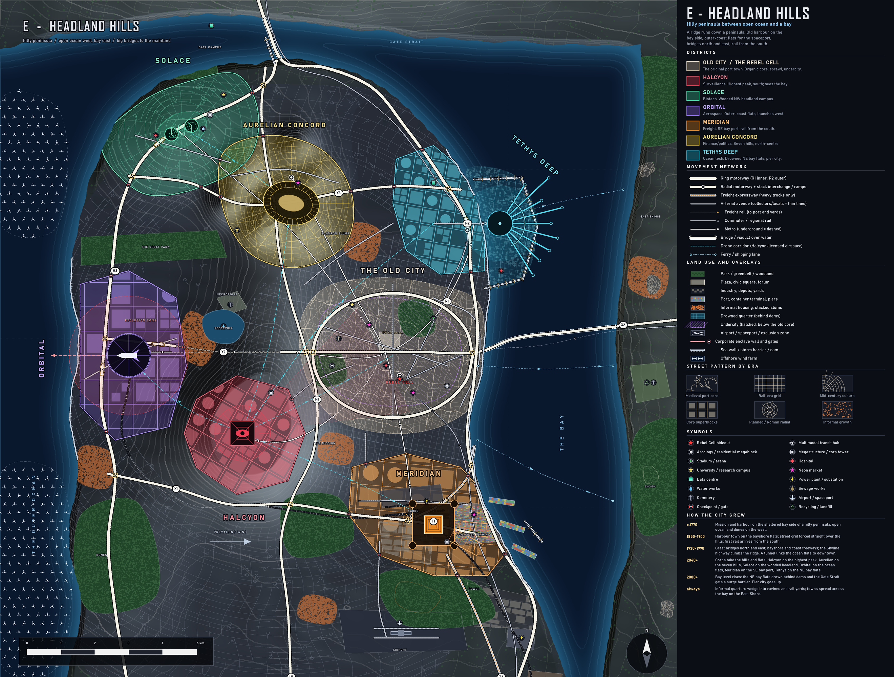

# E - HEADLAND HILLS (peninsula city)

**Concept.** A hilly peninsula with open ocean on the west and a bay on the east, joined to the mainland in the south and bridged north (strait) and east (bay). The old harbour sits mid-bay-shore; summit and flat sites are shared out among the corps. It is the most dramatic terrain and the most iconic bridges.

**Terrain.** A N-S ridge with a high peak in the south, seven hills in the north-centre, a wooded NW headland, wind-blown dune flats on the west coast, bay flats in the NE. Prevailing wind from the west.

## How it evolved
- **c.1770** Mission and harbour on the sheltered bay side.
- **1850-1900** Harbour town on the bayshore flats; the street grid is forced straight over the hills; first rail from the south.
- **1930-1990** Great bridges north and east; bayshore and coast freeways; Skyline highway on the ridge; a tunnel links the ocean flats to downtown.
- **2040+** Corps take the hills and flats; walled districts with gates on each freeway.
- **2080+** Bay level rises: the NE flats drown behind dams; surge barrier under the Gate Bridge; pier city.
- **Always** Informal quarters in ravines and rail yards; towns across the bay.

## Why each district is where it is
| District | Site | Logic |
|---|---|---|
| Old City | Mid bay shore | Sheltered harbour, the only flat ground big enough; undercity beneath |
| Halcyon | Highest peak (south) | Sees the whole bay and the old city; 5 km sightline cone |
| Solace | Wooded NW headland | Quiet parkland campus, clean air, near the strait |
| Aurelian | Seven hills (north-centre) | Hills, forum, Circus Aurelius on the saddle |
| Tethys | NE bay flats | Flat, low and flood-prone; dams and pier city in the bay |
| Meridian | SE bay shore | Deep water, rail from the south, freight expressway to the mainland |
| Orbital | West ocean flats | Open land at the edge, launch west over the ocean; freight reaches it by tunnel |

## Key planning moves
- **Highways:** H1 Skyline (ridge), H2 Bayshore (east), H3 Coast (west) form a loop with three cross-routes (X1 south, X2 Bay Bridge via tunnel under the ridge, X3 north); R1 round the old core; Gate and Bay bridges.
- **Rail:** freight from the south to the port yards, a tunnel freight line to Orbital; commuter lines south, north across the Gate Strait and via a transbay tunnel; three metros.
- **Land use:** airport on the southern isthmus, industry by the SE port and power station, parks as the great west-east park and ridge open space.
- **Blocks by era:** hill grid forced straight, organic harbour core, superblocks for the corps, curvilinear suburbs on the isthmus.

## Gameplay readability
- **Good:** strongest topographic identity; each corp has a summit-or-flat reason; bridges are strong landmarks and raid entry points.
- **Weak:** portrait-shaped, which fits a landscape screen poorly; only four districts are near the centre (far:near 2.0, Solace at 8.9 km); the mainland is a wasted strip; hills read as texture rather than gameplay.
