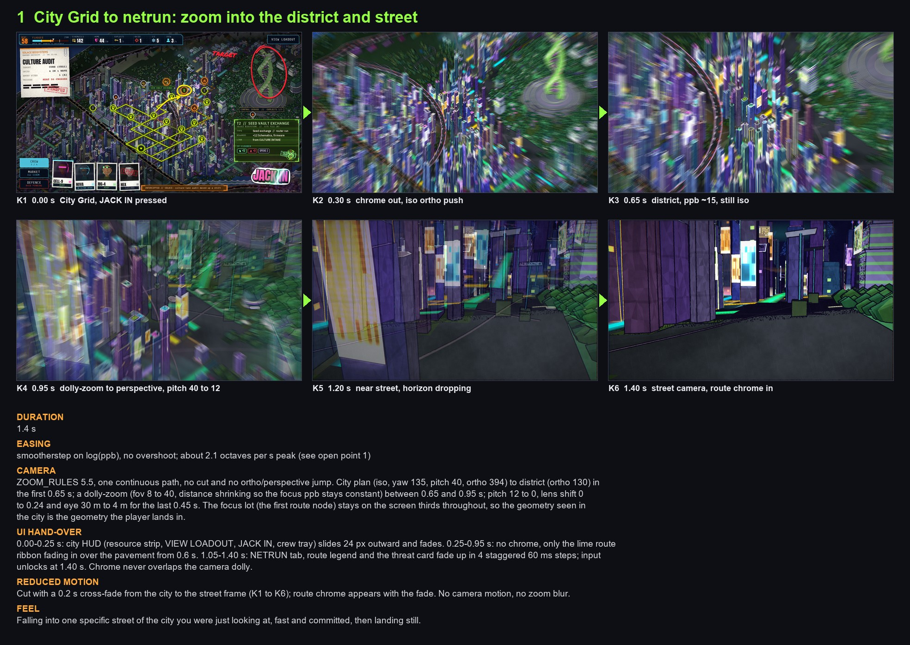
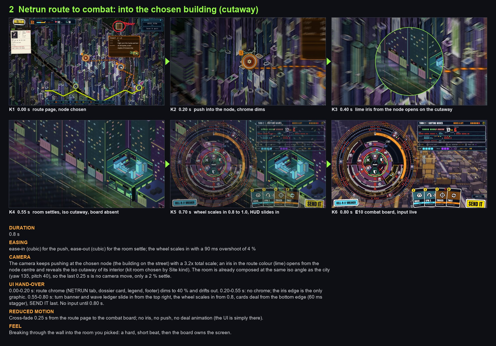
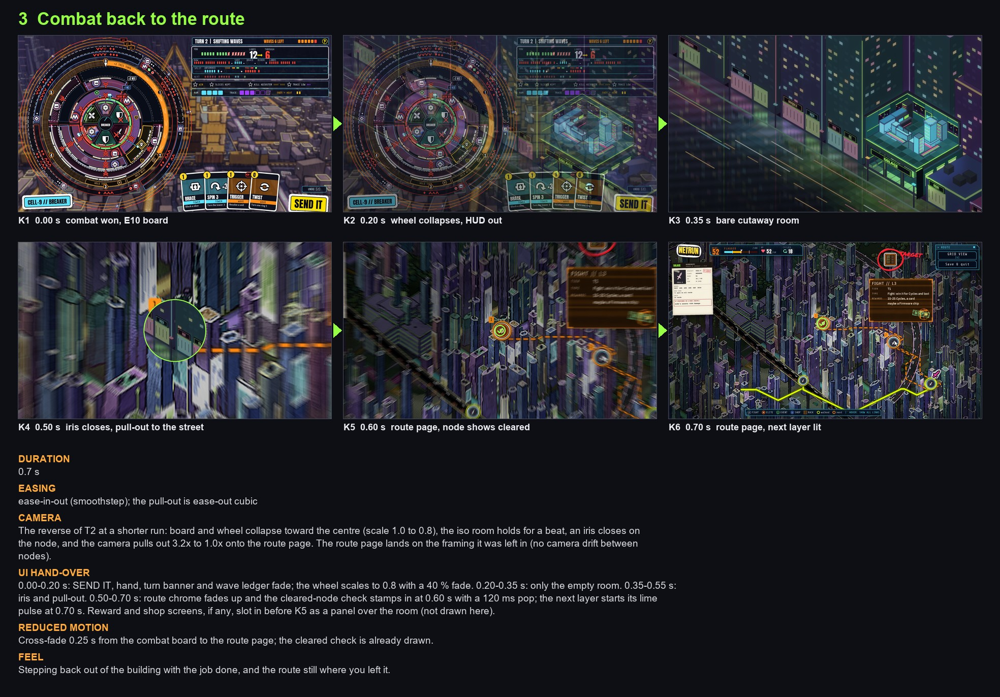
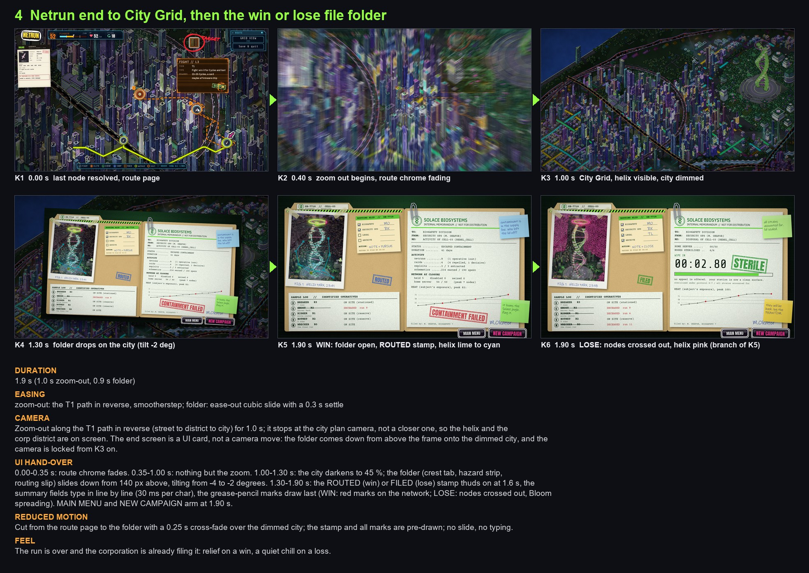
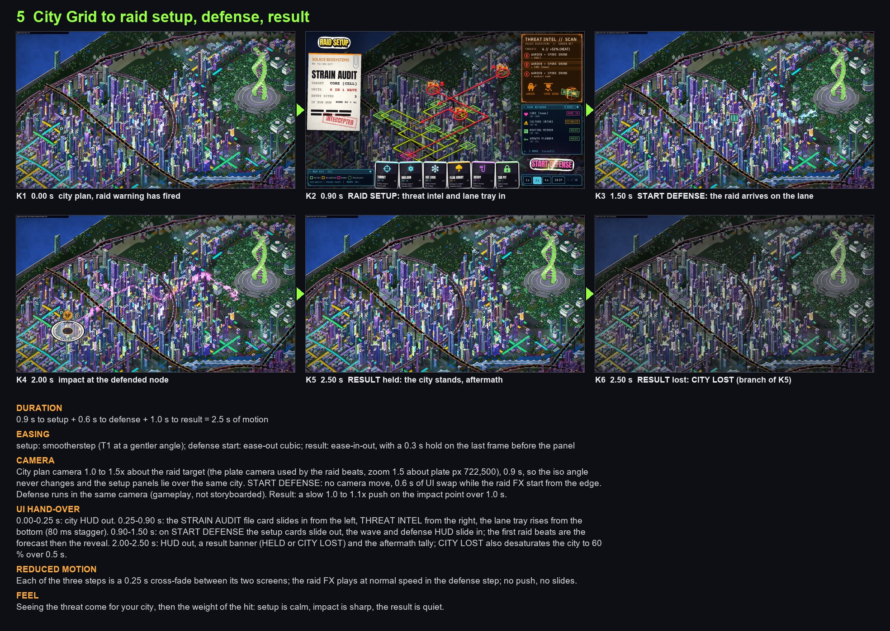
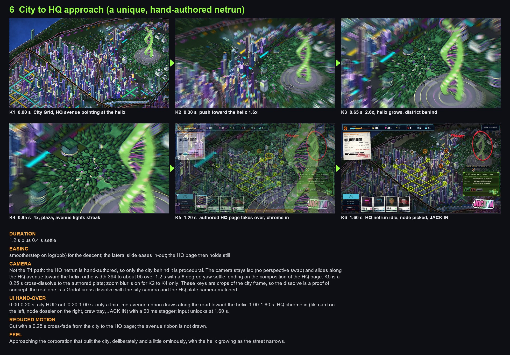

# Transitions storyboard (art-pass, 2026-10-30)

Concept job, assembled from existing frames (netrun_cel/godot_zoom, cohesion/map_pages_r42, combat_backdrop/v2, solace_endscreens/v2, tide_raid/G1_parity/final_proposed, the E10 plate) with crops, scaling, blends, iris and zoom blur. No Godot work, no game design. Intermediate frames are fakes: crops of the nearest real frame, soft at 3x to 4x. They prove sequence and timing, not polish. Built by `scripts/build.py`.

`sheet.jpg` shows all six strips; one jpg per transition follows.

## Timing table

| # | Transition | Full motion | Reduced motion | Easing |
|---|---|---|---|---|
| t1 | City Grid to netrun: zoom into the district and street | 1.4 s | 0.25 s cross-fade | smootherstep on log(ppb), no overshoot; about 2.1 octaves per s peak (see open point 1) |
| t2 | Netrun route to combat: into the chosen building (cutaway) | 0.8 s | 0.25 s cross-fade | ease-in (cubic) for the push, ease-out (cubic) for the room settle; the wheel scales in with a 90 ms overshoot of 4 % |
| t3 | Combat back to the route | 0.7 s | 0.25 s cross-fade | ease-in-out (smoothstep); the pull-out is ease-out cubic |
| t4 | Netrun end to City Grid, then the win or lose file folder | 1.9 s (1.0 s zoom-out, 0.9 s folder) | 0.25 s cross-fade | zoom-out: the T1 path in reverse, smootherstep; folder: ease-out cubic slide with a 0.3 s settle |
| t5 | City Grid to raid setup, defense, result | 0.9 s to setup + 0.6 s to defense + 1.0 s to result = 2.5 s of motion | 0.25 s cross-fade | setup: smootherstep (T1 at a gentler angle); defense start: ease-out cubic; result: ease-in-out, with a 0.3 s hold on the last frame before the panel |
| t6 | City to HQ approach (a unique, hand-authored netrun) | 1.2 s plus 0.4 s settle | 0.25 s cross-fade | smootherstep on log(ppb) for the descent; the lateral slide eases in-out; the HQ page then holds still |

Consistency rules used: scripted zoom between bands 1.4 s; a hard entry into a building 0.8 s; leaving it 0.7 s (shorter than entering: the player already knows where they are); no UI on screen while the camera moves through the district; every reduced-motion variant is a cross-fade of 0.25 s (under the 0.3 s cap) with the chrome appearing with it.

## 1  City Grid to netrun: zoom into the district and street

- **Keys:** K1  0.00 s  City Grid, JACK IN pressed; K2  0.30 s  chrome out, iso ortho push; K3  0.65 s  district, ppb ~15, still iso; K4  0.95 s  dolly-zoom to perspective, pitch 40 to 12; K5  1.20 s  near street, horizon dropping; K6  1.40 s  street camera, route chrome in
- **Duration:** 1.4 s
- **Easing:** smootherstep on log(ppb), no overshoot; about 2.1 octaves per s peak (see open point 1)
- **Camera path:** ZOOM_RULES 5.5, one continuous path, no cut and no ortho/perspective jump. City plan (iso, yaw 135, pitch 40, ortho 394) to district (ortho 130) in the first 0.65 s; a dolly-zoom (fov 8 to 40, distance shrinking so the focus ppb stays constant) between 0.65 and 0.95 s; pitch 12 to 0, lens shift 0 to 0.24 and eye 30 m to 4 m for the last 0.45 s. The focus lot (the first route node) stays on the screen thirds throughout, so the geometry seen in the city is the geometry the player lands in.
- **UI hand-over:** 0.00-0.25 s: city HUD (resource strip, VIEW LOADOUT, JACK IN, crew tray) slides 24 px outward and fades. 0.25-0.95 s: no chrome, only the lime route ribbon fading in over the pavement from 0.6 s. 1.05-1.40 s: NETRUN tab, route legend and the threat card fade up in 4 staggered 60 ms steps; input unlocks at 1.40 s. Chrome never overlaps the camera dolly.
- **Reduced motion:** Cut with a 0.2 s cross-fade from the city to the street frame (K1 to K6); route chrome appears with the fade. No camera motion, no zoom blur.
- **Feel:** Falling into one specific street of the city you were just looking at, fast and committed, then landing still.

## 2  Netrun route to combat: into the chosen building (cutaway)

- **Keys:** K1  0.00 s  route page, node chosen; K2  0.20 s  push into the node, chrome dims; K3  0.40 s  lime iris from the node opens on the cutaway; K4  0.55 s  room settles, iso cutaway, board absent; K5  0.70 s  wheel scales in 0.8 to 1.0, HUD slides in; K6  0.80 s  E10 combat board, input live
- **Duration:** 0.8 s
- **Easing:** ease-in (cubic) for the push, ease-out (cubic) for the room settle; the wheel scales in with a 90 ms overshoot of 4 %
- **Camera path:** The camera keeps pushing at the chosen node (the building on the street) with a 3.2x total scale; an iris in the route colour (lime) opens from the node centre and reveals the iso cutaway of its interior (kit room chosen by Site kind). The room is already composed at the same iso angle as the city (yaw 135, pitch 40), so the last 0.25 s is no camera move, only a 2 % settle.
- **UI hand-over:** 0.00-0.20 s: route chrome (NETRUN tab, dossier card, legend, footer) dims to 40 % and drifts out. 0.20-0.55 s: no chrome; the iris edge is the only graphic. 0.55-0.80 s: turn banner and wave ledger slide in from the top right, the wheel scales in from 0.8, cards deal from the bottom edge (60 ms stagger), SEND IT last. No input until 0.80 s.
- **Reduced motion:** Cross-fade 0.25 s from the route page to the combat board; no iris, no push, no deal animation (the UI is simply there).
- **Feel:** Breaking through the wall into the room you picked: a hard, short beat, then the board owns the screen.

## 3  Combat back to the route

- **Keys:** K1  0.00 s  combat won, E10 board; K2  0.20 s  wheel collapses, HUD out; K3  0.35 s  bare cutaway room; K4  0.50 s  iris closes, pull-out to the street; K5  0.60 s  route page, node shows cleared; K6  0.70 s  route page, next layer lit
- **Duration:** 0.7 s
- **Easing:** ease-in-out (smoothstep); the pull-out is ease-out cubic
- **Camera path:** The reverse of T2 at a shorter run: board and wheel collapse toward the centre (scale 1.0 to 0.8), the iso room holds for a beat, an iris closes on the node, and the camera pulls out 3.2x to 1.0x onto the route page. The route page lands on the framing it was left in (no camera drift between nodes).
- **UI hand-over:** 0.00-0.20 s: SEND IT, hand, turn banner and wave ledger fade; the wheel scales to 0.8 with a 40 % fade. 0.20-0.35 s: only the empty room. 0.35-0.55 s: iris and pull-out. 0.50-0.70 s: route chrome fades up and the cleared-node check stamps in at 0.60 s with a 120 ms pop; the next layer starts its lime pulse at 0.70 s. Reward and shop screens, if any, slot in before K5 as a panel over the room (not drawn here).
- **Reduced motion:** Cross-fade 0.25 s from the combat board to the route page; the cleared check is already drawn.
- **Feel:** Stepping back out of the building with the job done, and the route still where you left it.

## 4  Netrun end to City Grid, then the win or lose file folder

- **Keys:** K1  0.00 s  last node resolved, route page; K2  0.40 s  zoom out begins, route chrome fading; K3  1.00 s  City Grid, helix visible, city dimmed; K4  1.30 s  folder drops on the city (tilt -2 deg); K5  1.90 s  WIN: folder open, ROUTED stamp, helix lime to cyan; K6  1.90 s  LOSE: nodes crossed out, helix pink (branch of K5)
- **Duration:** 1.9 s (1.0 s zoom-out, 0.9 s folder)
- **Easing:** zoom-out: the T1 path in reverse, smootherstep; folder: ease-out cubic slide with a 0.3 s settle
- **Camera path:** Zoom-out along the T1 path in reverse (street to district to city) for 1.0 s; it stops at the city plan camera, not a closer one, so the helix and the corp district are on screen. The end screen is a UI card, not a camera move: the folder comes down from above the frame onto the dimmed city, and the camera is locked from K3 on.
- **UI hand-over:** 0.00-0.35 s: route chrome fades. 0.35-1.00 s: nothing but the zoom. 1.00-1.30 s: the city darkens to 45 %; the folder (crest tab, hazard strip, routing slip) slides down from 140 px above, tilting from -4 to -2 degrees. 1.30-1.90 s: the ROUTED (win) or FILED (lose) stamp thuds on at 1.6 s, the summary fields type in line by line (30 ms per char), the grease-pencil marks draw last (WIN: red marks on the network; LOSE: nodes crossed out, Bloom spreading). MAIN MENU and NEW CAMPAIGN arm at 1.90 s.
- **Reduced motion:** Cut from the route page to the folder with a 0.25 s cross-fade over the dimmed city; the stamp and all marks are pre-drawn; no slide, no typing.
- **Feel:** The run is over and the corporation is already filing it: relief on a win, a quiet chill on a loss.

## 5  City Grid to raid setup, defense, result

- **Keys:** K1  0.00 s  city plan, raid warning has fired; K2  0.90 s  RAID SETUP: threat intel and lane tray in; K3  1.50 s  START DEFENSE: the raid arrives on the lane; K4  2.00 s  impact at the defended node; K5  2.50 s  RESULT held: the city stands, aftermath; K6  2.50 s  RESULT lost: CITY LOST (branch of K5)
- **Duration:** 0.9 s to setup + 0.6 s to defense + 1.0 s to result = 2.5 s of motion
- **Easing:** setup: smootherstep (T1 at a gentler angle); defense start: ease-out cubic; result: ease-in-out, with a 0.3 s hold on the last frame before the panel
- **Camera path:** City plan camera 1.0 to 1.5x about the raid target (the plate camera used by the raid beats, zoom 1.5 about plate px 722,500), 0.9 s, so the iso angle never changes and the setup panels lie over the same city. START DEFENSE: no camera move, 0.6 s of UI swap while the raid FX start from the edge. Defense runs in the same camera (gameplay, not storyboarded). Result: a slow 1.0 to 1.1x push on the impact point over 1.0 s.
- **UI hand-over:** 0.00-0.25 s: city HUD out. 0.25-0.90 s: the STRAIN AUDIT file card slides in from the left, THREAT INTEL from the right, the lane tray rises from the bottom (80 ms stagger). 0.90-1.50 s: on START DEFENSE the setup cards slide out, the wave and defense HUD slide in; the first raid beats are the forecast then the reveal. 2.00-2.50 s: HUD out, a result banner (HELD or CITY LOST) and the aftermath tally; CITY LOST also desaturates the city to 60 % over 0.5 s.
- **Reduced motion:** Each of the three steps is a 0.25 s cross-fade between its two screens; the raid FX plays at normal speed in the defense step; no push, no slides.
- **Feel:** Seeing the threat come for your city, then the weight of the hit: setup is calm, impact is sharp, the result is quiet.

## 6  City to HQ approach (a unique, hand-authored netrun)

- **Keys:** K1  0.00 s  City Grid, HQ avenue pointing at the helix; K2  0.30 s  push toward the helix 1.6x; K3  0.65 s  2.6x, helix grows, district behind; K4  0.95 s  4x, plaza, avenue lights streak; K5  1.20 s  authored HQ page takes over, chrome in; K6  1.60 s  HQ netrun idle, node picked, JACK IN
- **Duration:** 1.2 s plus 0.4 s settle
- **Easing:** smootherstep on log(ppb) for the descent; the lateral slide eases in-out; the HQ page then holds still
- **Camera path:** Not the T1 path: the HQ netrun is hand-authored, so only the city behind it is procedural. The camera stays iso (no perspective swap) and slides along the HQ avenue toward the helix: ortho width 394 to about 95 over 1.2 s with a 6 degree yaw settle, ending on the composition of the HQ page. K5 is a 0.25 s cross-dissolve to the authored plate; zoom blur is on for K2 to K4 only. These keys are crops of the city frame, so the dissolve is a proof of concept; the real one is a Godot cross-dissolve with the city camera and the HQ plate camera matched.
- **UI hand-over:** 0.00-0.20 s: city HUD out. 0.20-1.00 s: only a thin lime avenue ribbon draws along the road toward the helix. 1.00-1.60 s: HQ chrome in (file card on the left, node dossier on the right, crew tray, JACK IN) with a 60 ms stagger; input unlocks at 1.60 s.
- **Reduced motion:** Cut with a 0.25 s cross-fade from the city to the HQ page; the avenue ribbon is not drawn.
- **Feel:** Approaching the corporation that built the city, deliberately and a little ominously, with the helix growing as the street narrows.

## Open points (raised for art-pass; not decided here)

1. **T1 speed vs ZOOM_RULES 5.5.** 5.5 caps the zoom at 0.5 octaves of ppb per second (a x3 zoom takes about 2.2 s). The full path from city (ppb 4.9) to street (ppb 38) is about 3 octaves, so the cap gives about 6 s, not 1.4 s. This storyboard assumes the cap is the rate for the player-driven wheel zoom and that the scripted JACK IN move is exempt (peak about 2.1 octaves per s at smootherstep). If the cap must stay, T1 becomes about 6 s and needs a skip. Designer or build to decide; the roadmap asks for about 1.4 s.
2. **Street camera vs route page.** T1 lands on the street camera (K6); T2 and T3 start and end on the iso route page, because that is the existing frame. Whether these are one screen or two is a build question.
3. **T2/T3 assume the interior kit room is composed at the city iso angle** (as the v2 backdrops are), so the cutaway reveal needs no camera swap. A procedural kit render for the real Site kinds is still to come.
4. **T4 stops the zoom-out at the city plan camera** so the folder lands on the city; the designer may prefer the folder over the street. Cheap to change (K3).
5. **T5** shows the held and lost results as branches; the forecast beat is the opening 0.3 s of the defense step and has no key. raid_setup is the existing r42 map page.
6. **T6 K2 to K5 are crops of the city frame** (soft at 4x). The real HQ approach needs a render of the avenue-to-helix camera, and the city and HQ plate cameras must match for the dissolve to read.
7. **End screens** use v2 variant A as the stand-in (the designer picked image slot B).
