# Transitions storyboard v2 (art-pass, 2026-10-30): the designer's 12 (ART CALL 49)

Replaces nothing in v1 (the first storyboard, 962ebb45, is wrong and stays as a record). Built by `scripts/build2.py` from existing frames plus labelled mocks. No Godot work, no game design. Every key carries a badge: **REAL** (green frame) is an existing frame or an existing crop of one; **MOCK** (amber frame) is composed here (crops, blends, bit streams, marker overlays, a pasted card crop, the failure screen). Mocked frames show sequence and timing only.

- `flow.jpg`: how the 12 connect. `sheet.jpg`: all strips on one page.

## Master timing table

| # | Transition | Duration | Easing | Reduced motion |
|---|---|---|---|---|
| T01 | City Grid to raid view | 1.2 s | smootherstep on log(zoom); no overshoot | 0.25 s cross-fade |
| T02 | Raid view to select a netrun and jack in | 0.6 s (select, 0.2 s; jack-in press, 0.4 s) | ease-out cubic for the card; the press is a 90 ms flash then ease-in dim | 0.25 s cross-fade |
| T03 | Jack-in zoom to the netrun street along the node route | 1.4 s | smootherstep on log(ppb); the old wheel-circle zoom is removed | 0.25 s cross-fade |
| T04 | Select a room on the netrun street and zoom into it (combat, or event/other Site) | 0.8 s | ease-in cubic for the push, ease-out cubic for the room settle | 0.25 s cross-fade |
| T05 | Room to combat: the wheel flies in, enemy rings fly from the room as binary bits | 1.2 s | wheel: ease-out cubic with a 4 % overshoot; bits: ease-in-out along curved paths; rings lock with a 90 ms snap | 0.25 s cross-fade |
| T06 | Combat ends, the board dissolves to bits, back to the netrun, or the run fails | 0.8 s back to the netrun; 0.6 s plus hold for the failure screen | bits: ease-in; street: ease-out cubic; failure: hard glitch cut, then a 0.3 s settle | 0.25 s cross-fade |
| T07 | Netrun, win or lose, back up to the raid view (the raid node changes) | 1.2 s | the T3 path in reverse: smootherstep; the node change is a 0.3 s pop after landing | 0.25 s cross-fade |
| T08 | Raid view lose: the dossier folder ends the campaign (image slot B) | 1.6 s | city dims: ease-in-out; folder: ease-out cubic slide, 0.3 s settle | 0.25 s cross-fade |
| T09 | Raid view to planning the raid, and back | 0.7 s each way | smootherstep in; ease-out cubic out | 0.25 s cross-fade |
| T10 |  Raid view to starting a raid, the result, and back to the raid view | 0.9 s in, raid plays, 1.0 s to result, 0.7 s back | ease-out cubic for the raid; result: ease-in-out with a 0.3 s hold; back: smoothstep | 0.25 s cross-fade |
| T11 |  Raid view to the HQ netrun: a special fly-in to the hand-authored HQ | 1.8 s | smootherstep on log(zoom); the final approach decelerates over the last 0.5 s | 0.25 s cross-fade |
| T12 |  Custom HQ netrun to campaign win, then the dossier folder (win, image slot B) | 1.4 s plus 0.9 s folder | helix recolour: ease-in-out; flash: 90 ms; folder: ease-out cubic slide, 0.3 s settle | 0.25 s cross-fade |

Consistency: the big zoom through the city (T3) is 1.4 s and T1 is a lighter 1.2 s; entering a room (T4) is 0.8 s and leaving it (T6) is 0.8 s; every UI card or folder slides in 0.3 to 0.5 s with a 60 to 80 ms stagger; no chrome is on screen while the camera moves; every reduced-motion variant is a 0.25 s cross-fade (under the 0.3 s cap).

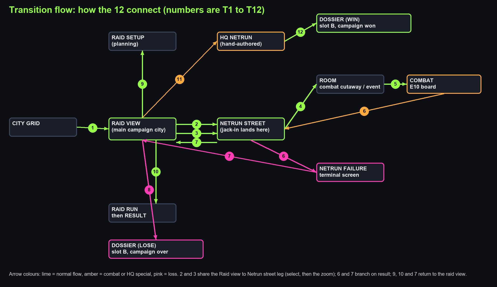

## T1  City Grid to raid view

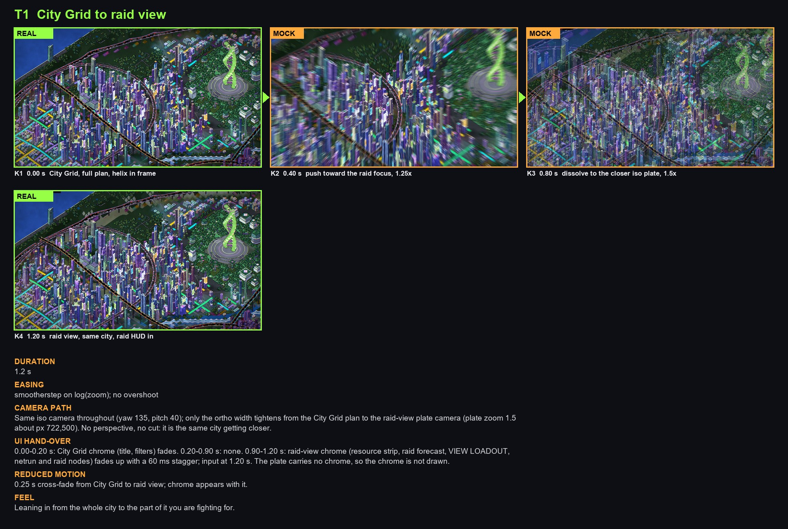

- **Keys:** K1  0.00 s  City Grid, full plan, helix in frame [real]; K2  0.40 s  push toward the raid focus, 1.25x [mock]; K3  0.80 s  dissolve to the closer iso plate, 1.5x [mock]; K4  1.20 s  raid view, same city, raid HUD in [real]
- **Duration:** 1.2 s
- **Easing:** smootherstep on log(zoom); no overshoot
- **Camera path:** Same iso camera throughout (yaw 135, pitch 40); only the ortho width tightens from the City Grid plan to the raid-view plate camera (plate zoom 1.5 about px 722,500). No perspective, no cut: it is the same city getting closer.
- **UI hand-over:** 0.00-0.20 s: City Grid chrome (title, filters) fades. 0.20-0.90 s: none. 0.90-1.20 s: raid-view chrome (resource strip, raid forecast, VIEW LOADOUT, netrun and raid nodes) fades up with a 60 ms stagger; input at 1.20 s. The plate carries no chrome, so the chrome is not drawn.
- **Reduced motion:** 0.25 s cross-fade from City Grid to raid view; chrome appears with it.
- **Feel:** Leaning in from the whole city to the part of it you are fighting for.

## T2  Raid view to select a netrun and jack in

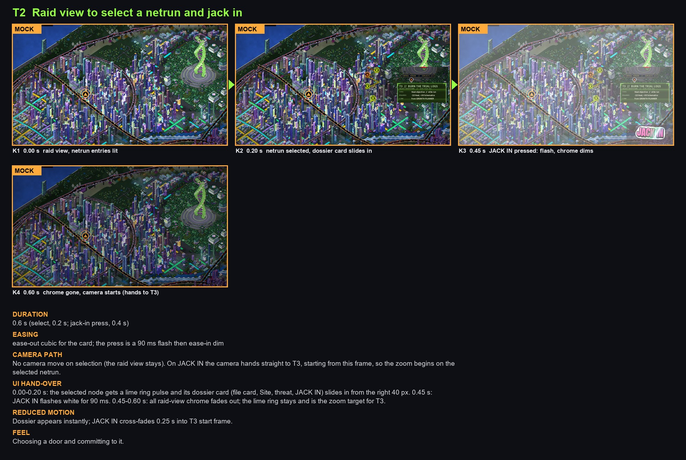

- **Keys:** K1  0.00 s  raid view, netrun entries lit [mock]; K2  0.20 s  netrun selected, dossier card slides in [mock]; K3  0.45 s  JACK IN pressed: flash, chrome dims [mock]; K4  0.60 s  chrome gone, camera starts (hands to T3) [mock]
- **Duration:** 0.6 s (select, 0.2 s; jack-in press, 0.4 s)
- **Easing:** ease-out cubic for the card; the press is a 90 ms flash then ease-in dim
- **Camera path:** No camera move on selection (the raid view stays). On JACK IN the camera hands straight to T3, starting from this frame, so the zoom begins on the selected netrun.
- **UI hand-over:** 0.00-0.20 s: the selected node gets a lime ring pulse and its dossier card (file card, Site, threat, JACK IN) slides in from the right 40 px. 0.45 s: JACK IN flashes white for 90 ms. 0.45-0.60 s: all raid-view chrome fades out; the lime ring stays and is the zoom target for T3.
- **Reduced motion:** Dossier appears instantly; JACK IN cross-fades 0.25 s into T3 start frame.
- **Feel:** Choosing a door and committing to it.

## T3  Jack-in zoom to the netrun street along the node route

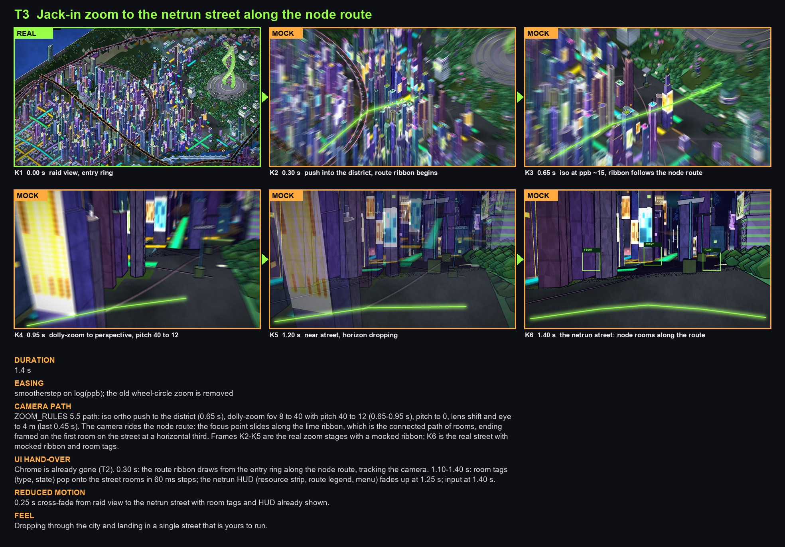

- **Keys:** K1  0.00 s  raid view, entry ring [real]; K2  0.30 s  push into the district, route ribbon begins [mock]; K3  0.65 s  iso at ppb ~15, ribbon follows the node route [mock]; K4  0.95 s  dolly-zoom to perspective, pitch 40 to 12 [mock]; K5  1.20 s  near street, horizon dropping [mock]; K6  1.40 s  the netrun street: node rooms along the route [mock]
- **Duration:** 1.4 s
- **Easing:** smootherstep on log(ppb); the old wheel-circle zoom is removed
- **Camera path:** ZOOM_RULES 5.5 path: iso ortho push to the district (0.65 s), dolly-zoom fov 8 to 40 with pitch 40 to 12 (0.65-0.95 s), pitch to 0, lens shift and eye to 4 m (last 0.45 s). The camera rides the node route: the focus point slides along the lime ribbon, which is the connected path of rooms, ending framed on the first room on the street at a horizontal third. Frames K2-K5 are the real zoom stages with a mocked ribbon; K6 is the real street with mocked ribbon and room tags.
- **UI hand-over:** Chrome is already gone (T2). 0.30 s: the route ribbon draws from the entry ring along the node route, tracking the camera. 1.10-1.40 s: room tags (type, state) pop onto the street rooms in 60 ms steps; the netrun HUD (resource strip, route legend, menu) fades up at 1.25 s; input at 1.40 s.
- **Reduced motion:** 0.25 s cross-fade from raid view to the netrun street with room tags and HUD already shown.
- **Feel:** Dropping through the city and landing in a single street that is yours to run.

## T4  Select a room on the netrun street and zoom into it (combat, or event/other Site)

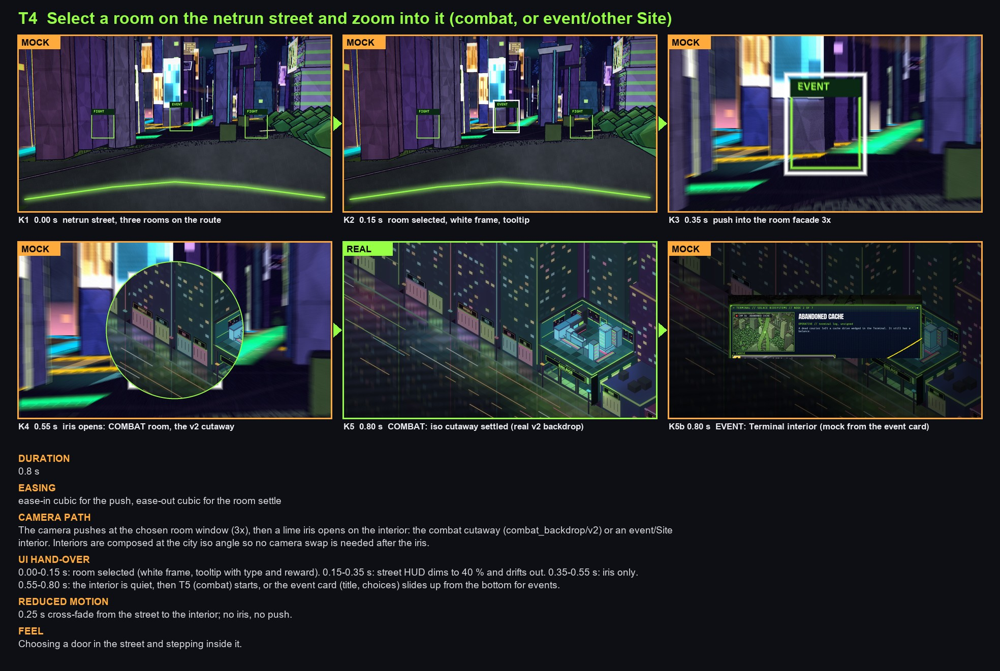

- **Keys:** K1  0.00 s  netrun street, three rooms on the route [mock]; K2  0.15 s  room selected, white frame, tooltip [mock]; K3  0.35 s  push into the room facade 3x [mock]; K4  0.55 s  iris opens: COMBAT room, the v2 cutaway [mock]; K5  0.80 s  COMBAT: iso cutaway settled (real v2 backdrop) [real]; K5b 0.80 s  EVENT: Terminal interior (mock from the event card) [mock]
- **Duration:** 0.8 s
- **Easing:** ease-in cubic for the push, ease-out cubic for the room settle
- **Camera path:** The camera pushes at the chosen room window (3x), then a lime iris opens on the interior: the combat cutaway (combat_backdrop/v2) or an event/Site interior. Interiors are composed at the city iso angle so no camera swap is needed after the iris.
- **UI hand-over:** 0.00-0.15 s: room selected (white frame, tooltip with type and reward). 0.15-0.35 s: street HUD dims to 40 % and drifts out. 0.35-0.55 s: iris only. 0.55-0.80 s: the interior is quiet, then T5 (combat) starts, or the event card (title, choices) slides up from the bottom for events.
- **Reduced motion:** 0.25 s cross-fade from the street to the interior; no iris, no push.
- **Feel:** Choosing a door in the street and stepping inside it.

## T5  Room to combat: the wheel flies in, enemy rings fly from the room as binary bits

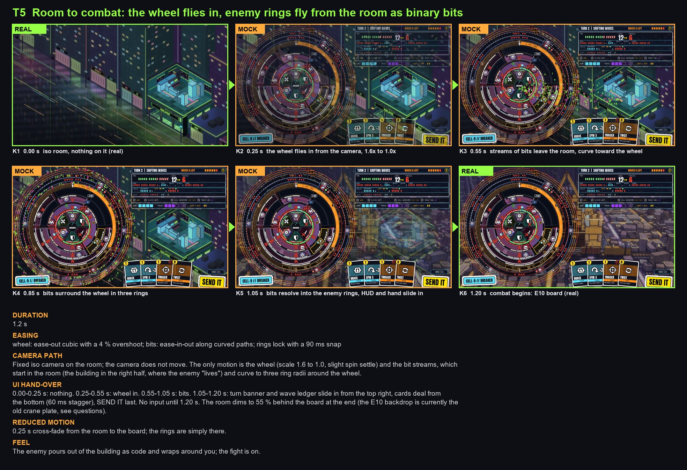

- **Keys:** K1  0.00 s  iso room, nothing on it (real) [real]; K2  0.25 s  the wheel flies in from the camera, 1.6x to 1.0x [mock]; K3  0.55 s  streams of bits leave the room, curve toward the wheel [mock]; K4  0.85 s  bits surround the wheel in three rings [mock]; K5  1.05 s  bits resolve into the enemy rings, HUD and hand slide in [mock]; K6  1.20 s  combat begins: E10 board (real) [real]
- **Duration:** 1.2 s
- **Easing:** wheel: ease-out cubic with a 4 % overshoot; bits: ease-in-out along curved paths; rings lock with a 90 ms snap
- **Camera path:** Fixed iso camera on the room; the camera does not move. The only motion is the wheel (scale 1.6 to 1.0, slight spin settle) and the bit streams, which start in the room (the building in the right half, where the enemy "lives") and curve to three ring radii around the wheel.
- **UI hand-over:** 0.00-0.25 s: nothing. 0.25-0.55 s: wheel in. 0.55-1.05 s: bits. 1.05-1.20 s: turn banner and wave ledger slide in from the top right, cards deal from the bottom (60 ms stagger), SEND IT last. No input until 1.20 s. The room dims to 55 % behind the board at the end (the E10 backdrop is currently the old crane plate, see questions).
- **Reduced motion:** 0.25 s cross-fade from the room to the board; the rings are simply there.
- **Feel:** The enemy pours out of the building as code and wraps around you; the fight is on.

## T6  Combat ends, the board dissolves to bits, back to the netrun, or the run fails

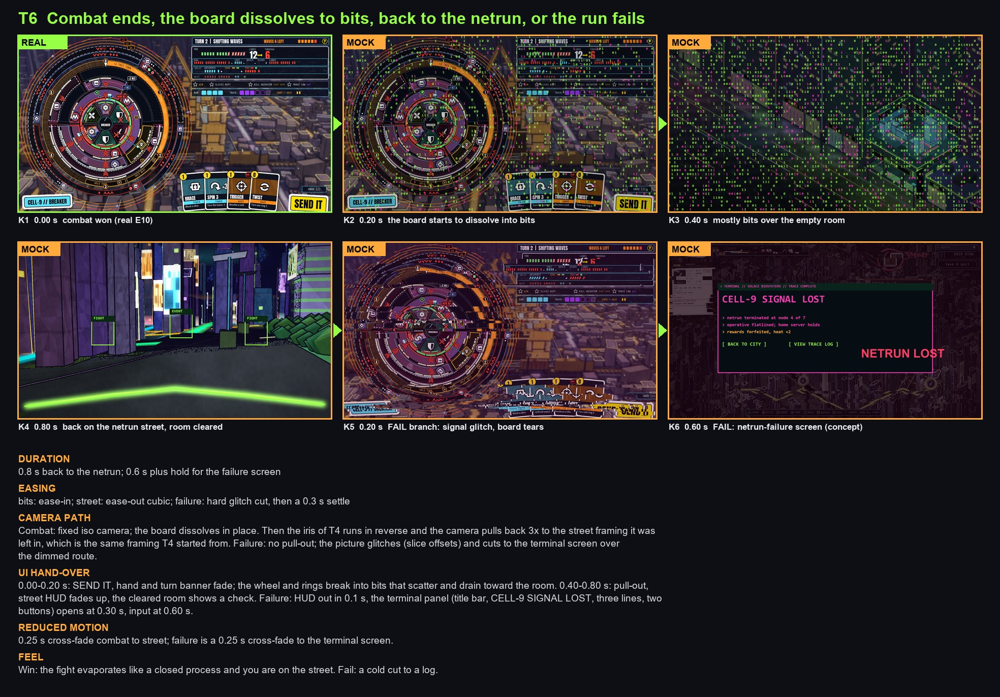

- **Keys:** K1  0.00 s  combat won (real E10) [real]; K2  0.20 s  the board starts to dissolve into bits [mock]; K3  0.40 s  mostly bits over the empty room [mock]; K4  0.80 s  back on the netrun street, room cleared [mock]; K5  0.20 s  FAIL branch: signal glitch, board tears [mock]; K6  0.60 s  FAIL: netrun-failure screen (concept) [mock]
- **Duration:** 0.8 s back to the netrun; 0.6 s plus hold for the failure screen
- **Easing:** bits: ease-in; street: ease-out cubic; failure: hard glitch cut, then a 0.3 s settle
- **Camera path:** Combat: fixed iso camera; the board dissolves in place. Then the iris of T4 runs in reverse and the camera pulls back 3x to the street framing it was left in, which is the same framing T4 started from. Failure: no pull-out; the picture glitches (slice offsets) and cuts to the terminal screen over the dimmed route.
- **UI hand-over:** 0.00-0.20 s: SEND IT, hand and turn banner fade; the wheel and rings break into bits that scatter and drain toward the room. 0.40-0.80 s: pull-out, street HUD fades up, the cleared room shows a check. Failure: HUD out in 0.1 s, the terminal panel (title bar, CELL-9 SIGNAL LOST, three lines, two buttons) opens at 0.30 s, input at 0.60 s.
- **Reduced motion:** 0.25 s cross-fade combat to street; failure is a 0.25 s cross-fade to the terminal screen.
- **Feel:** Win: the fight evaporates like a closed process and you are on the street. Fail: a cold cut to a log.

## T7  Netrun, win or lose, back up to the raid view (the raid node changes)

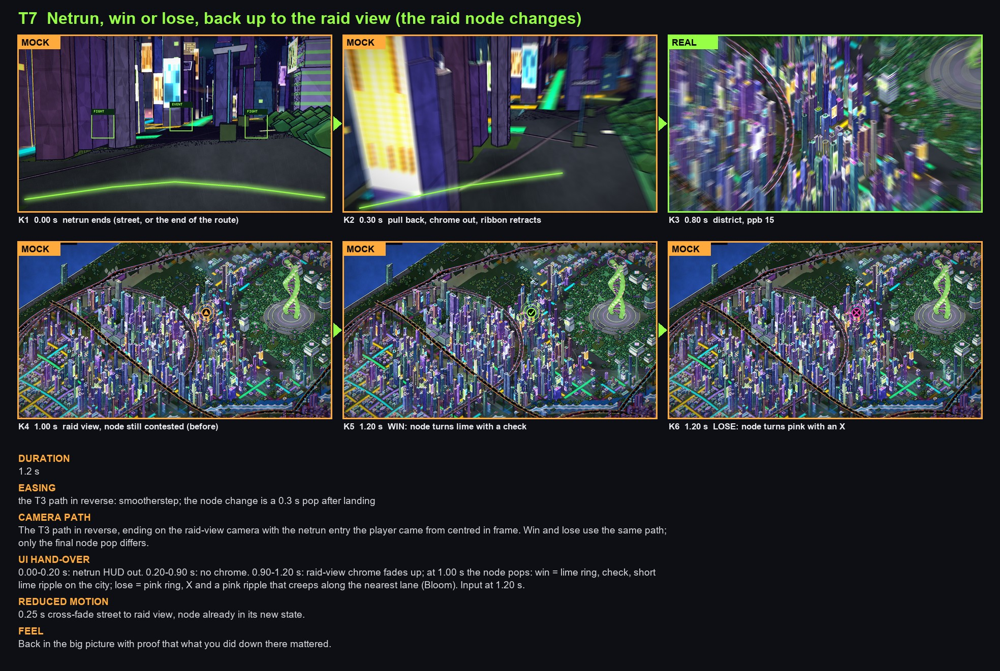

- **Keys:** K1  0.00 s  netrun ends (street, or the end of the route) [mock]; K2  0.30 s  pull back, chrome out, ribbon retracts [mock]; K3  0.80 s  district, ppb 15 [real]; K4  1.00 s  raid view, node still contested (before) [mock]; K5  1.20 s  WIN: node turns lime with a check [mock]; K6  1.20 s  LOSE: node turns pink with an X [mock]
- **Duration:** 1.2 s
- **Easing:** the T3 path in reverse: smootherstep; the node change is a 0.3 s pop after landing
- **Camera path:** The T3 path in reverse, ending on the raid-view camera with the netrun entry the player came from centred in frame. Win and lose use the same path; only the final node pop differs.
- **UI hand-over:** 0.00-0.20 s: netrun HUD out. 0.20-0.90 s: no chrome. 0.90-1.20 s: raid-view chrome fades up; at 1.00 s the node pops: win = lime ring, check, short lime ripple on the city; lose = pink ring, X and a pink ripple that creeps along the nearest lane (Bloom). Input at 1.20 s.
- **Reduced motion:** 0.25 s cross-fade street to raid view, node already in its new state.
- **Feel:** Back in the big picture with proof that what you did down there mattered.

## T8  Raid view lose: the dossier folder ends the campaign (image slot B)

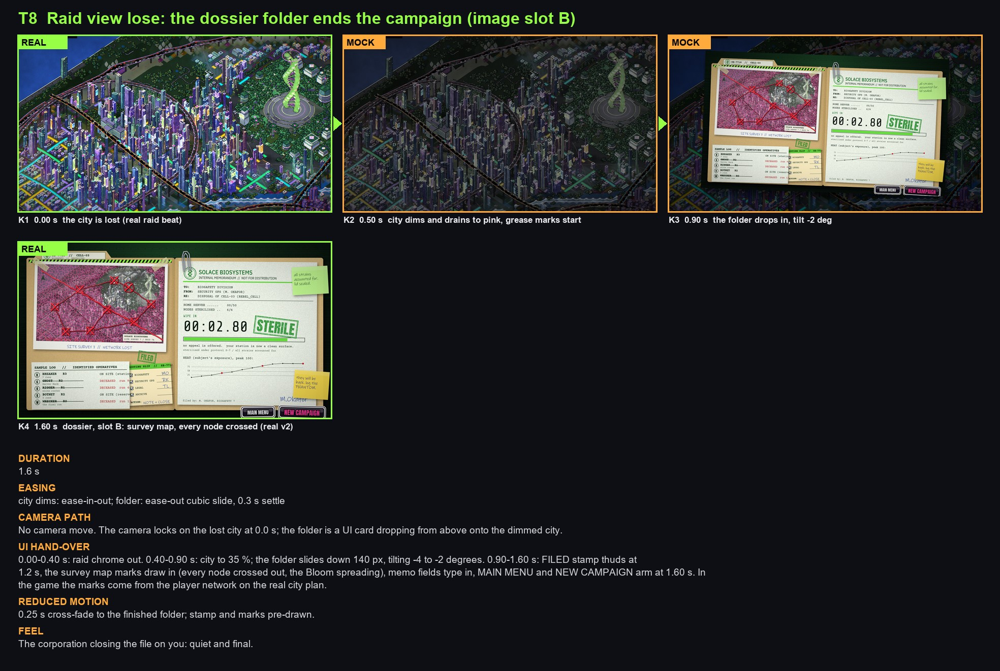

- **Keys:** K1  0.00 s  the city is lost (real raid beat) [real]; K2  0.50 s  city dims and drains to pink, grease marks start [mock]; K3  0.90 s  the folder drops in, tilt -2 deg [mock]; K4  1.60 s  dossier, slot B: survey map, every node crossed (real v2) [real]
- **Duration:** 1.6 s
- **Easing:** city dims: ease-in-out; folder: ease-out cubic slide, 0.3 s settle
- **Camera path:** No camera move. The camera locks on the lost city at 0.0 s; the folder is a UI card dropping from above onto the dimmed city.
- **UI hand-over:** 0.00-0.40 s: raid chrome out. 0.40-0.90 s: city to 35 %; the folder slides down 140 px, tilting -4 to -2 degrees. 0.90-1.60 s: FILED stamp thuds at 1.2 s, the survey map marks draw in (every node crossed out, the Bloom spreading), memo fields type in, MAIN MENU and NEW CAMPAIGN arm at 1.60 s. In the game the marks come from the player network on the real city plan.
- **Reduced motion:** 0.25 s cross-fade to the finished folder; stamp and marks pre-drawn.
- **Feel:** The corporation closing the file on you: quiet and final.

## T9  Raid view to planning the raid, and back

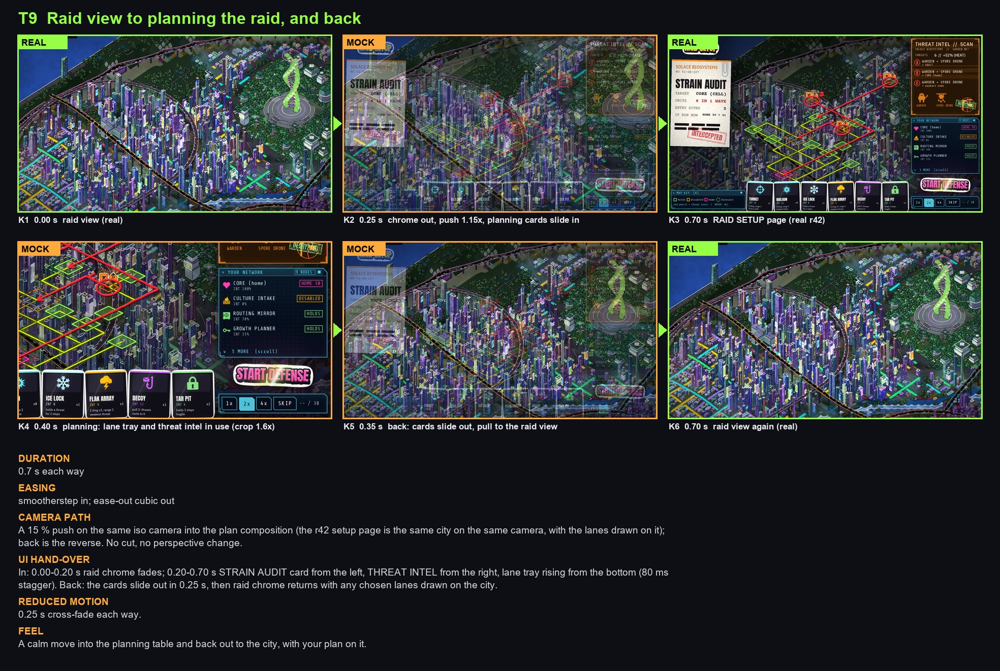

- **Keys:** K1  0.00 s  raid view (real) [real]; K2  0.25 s  chrome out, push 1.15x, planning cards slide in [mock]; K3  0.70 s  RAID SETUP page (real r42) [real]; K4  0.40 s  planning: lane tray and threat intel in use (crop 1.6x) [mock]; K5  0.35 s  back: cards slide out, pull to the raid view [mock]; K6  0.70 s  raid view again (real) [real]
- **Duration:** 0.7 s each way
- **Easing:** smootherstep in; ease-out cubic out
- **Camera path:** A 15 % push on the same iso camera into the plan composition (the r42 setup page is the same city on the same camera, with the lanes drawn on it); back is the reverse. No cut, no perspective change.
- **UI hand-over:** In: 0.00-0.20 s raid chrome fades; 0.20-0.70 s STRAIN AUDIT card from the left, THREAT INTEL from the right, lane tray rising from the bottom (80 ms stagger). Back: the cards slide out in 0.25 s, then raid chrome returns with any chosen lanes drawn on the city.
- **Reduced motion:** 0.25 s cross-fade each way.
- **Feel:** A calm move into the planning table and back out to the city, with your plan on it.

## T10  Raid view to starting a raid, the result, and back to the raid view

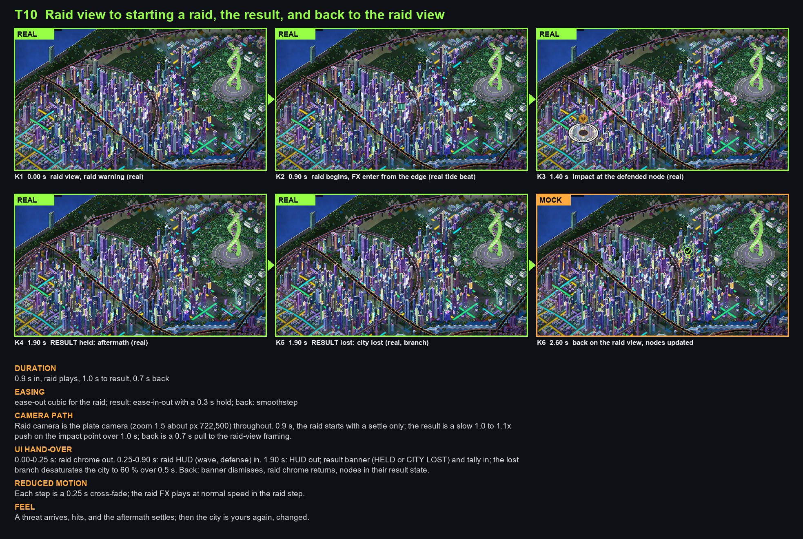

- **Keys:** K1  0.00 s  raid view, raid warning (real) [real]; K2  0.90 s  raid begins, FX enter from the edge (real tide beat) [real]; K3  1.40 s  impact at the defended node (real) [real]; K4  1.90 s  RESULT held: aftermath (real) [real]; K5  1.90 s  RESULT lost: city lost (real, branch) [real]; K6  2.60 s  back on the raid view, nodes updated [mock]
- **Duration:** 0.9 s in, raid plays, 1.0 s to result, 0.7 s back
- **Easing:** ease-out cubic for the raid; result: ease-in-out with a 0.3 s hold; back: smoothstep
- **Camera path:** Raid camera is the plate camera (zoom 1.5 about px 722,500) throughout. 0.9 s, the raid starts with a settle only; the result is a slow 1.0 to 1.1x push on the impact point over 1.0 s; back is a 0.7 s pull to the raid-view framing.
- **UI hand-over:** 0.00-0.25 s: raid chrome out. 0.25-0.90 s: raid HUD (wave, defense) in. 1.90 s: HUD out; result banner (HELD or CITY LOST) and tally in; the lost branch desaturates the city to 60 % over 0.5 s. Back: banner dismisses, raid chrome returns, nodes in their result state.
- **Reduced motion:** Each step is a 0.25 s cross-fade; the raid FX plays at normal speed in the raid step.
- **Feel:** A threat arrives, hits, and the aftermath settles; then the city is yours again, changed.

## T11  Raid view to the HQ netrun: a special fly-in to the hand-authored HQ

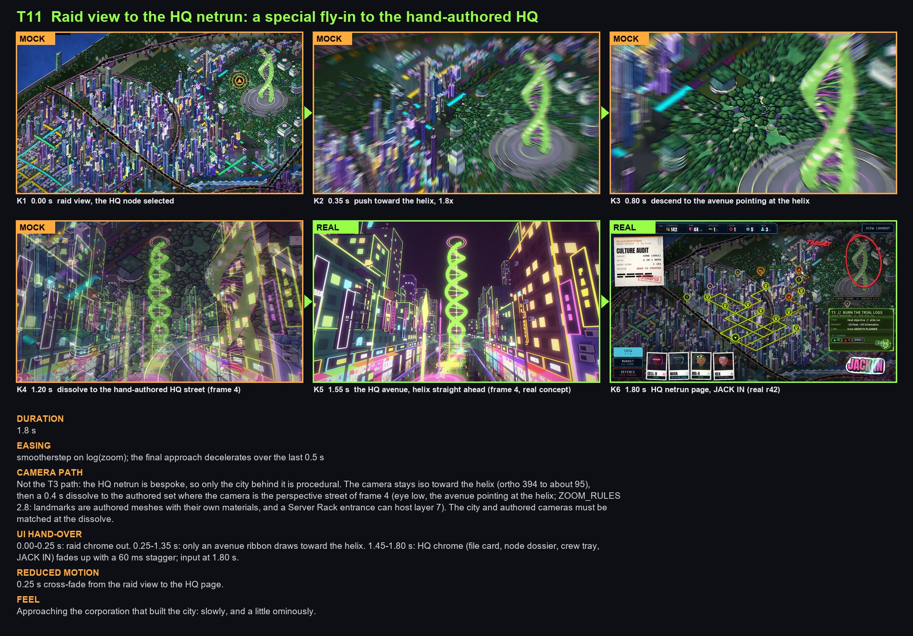

- **Keys:** K1  0.00 s  raid view, the HQ node selected [mock]; K2  0.35 s  push toward the helix, 1.8x [mock]; K3  0.80 s  descend to the avenue pointing at the helix [mock]; K4  1.20 s  dissolve to the hand-authored HQ street (frame 4) [mock]; K5  1.55 s  the HQ avenue, helix straight ahead (frame 4, real concept) [real]; K6  1.80 s  HQ netrun page, JACK IN (real r42) [real]
- **Duration:** 1.8 s
- **Easing:** smootherstep on log(zoom); the final approach decelerates over the last 0.5 s
- **Camera path:** Not the T3 path: the HQ netrun is bespoke, so only the city behind it is procedural. The camera stays iso toward the helix (ortho 394 to about 95), then a 0.4 s dissolve to the authored set where the camera is the perspective street of frame 4 (eye low, the avenue pointing at the helix; ZOOM_RULES 2.8: landmarks are authored meshes with their own materials, and a Server Rack entrance can host layer 7). The city and authored cameras must be matched at the dissolve.
- **UI hand-over:** 0.00-0.25 s: raid chrome out. 0.25-1.35 s: only an avenue ribbon draws toward the helix. 1.45-1.80 s: HQ chrome (file card, node dossier, crew tray, JACK IN) fades up with a 60 ms stagger; input at 1.80 s.
- **Reduced motion:** 0.25 s cross-fade from the raid view to the HQ page.
- **Feel:** Approaching the corporation that built the city: slowly, and a little ominously.

## T12  Custom HQ netrun to campaign win, then the dossier folder (win, image slot B)

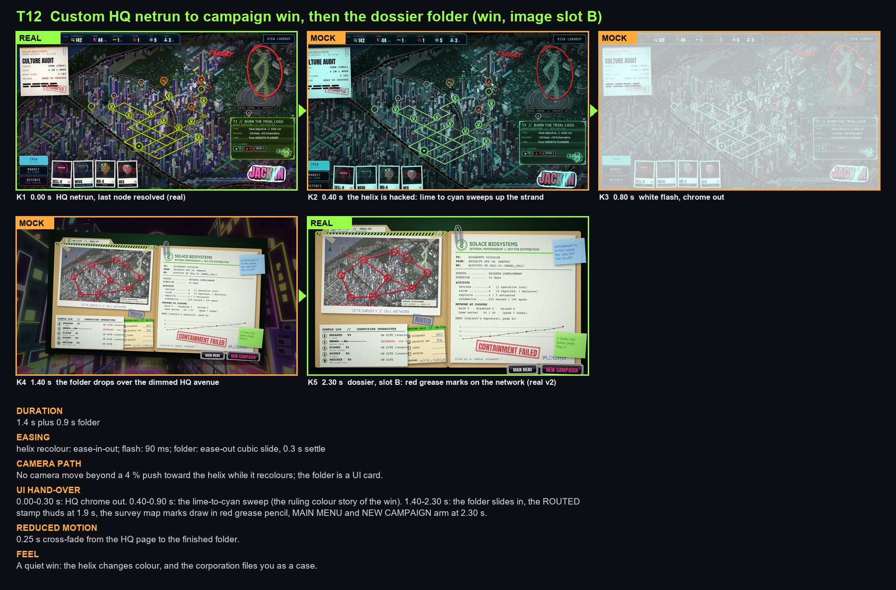

- **Keys:** K1  0.00 s  HQ netrun, last node resolved (real) [real]; K2  0.40 s  the helix is hacked: lime to cyan sweeps up the strand [mock]; K3  0.80 s  white flash, chrome out [mock]; K4  1.40 s  the folder drops over the dimmed HQ avenue [mock]; K5  2.30 s  dossier, slot B: red grease marks on the network (real v2) [real]
- **Duration:** 1.4 s plus 0.9 s folder
- **Easing:** helix recolour: ease-in-out; flash: 90 ms; folder: ease-out cubic slide, 0.3 s settle
- **Camera path:** No camera move beyond a 4 % push toward the helix while it recolours; the folder is a UI card.
- **UI hand-over:** 0.00-0.30 s: HQ chrome out. 0.40-0.90 s: the lime-to-cyan sweep (the ruling colour story of the win). 1.40-2.30 s: the folder slides in, the ROUTED stamp thuds at 1.9 s, the survey map marks draw in red grease pencil, MAIN MENU and NEW CAMPAIGN arm at 2.30 s.
- **Reduced motion:** 0.25 s cross-fade from the HQ page to the finished folder.
- **Feel:** A quiet win: the helix changes colour, and the corporation files you as a case.

## What is missing (art to be made before these can be real frames)

- **Event / shop / other Site interiors.** Only the combat server-room cutaway exists (combat_backdrop/v2). T4 K5b is a mock: the Terminal event card (solace_vertical/nodes, now_event) pasted over a dimmed cutaway. Each non-combat Site kind (Terminal, Mainframe/shop, Server Rack) needs its own interior kit room at the city iso angle.
- **The netrun street with rooms.** No frame shows a street of connected node rooms; T3 K6 and T4 use the real street (stage 5) with mocked ribbon and room tags.
- **Raid-view chrome and the raid node states** (contested, held, lost) are mocked markers; the plate has no HUD.
- **Bits FX and the enemy-ring fly-out** (T5, T6) are drawn digits only; they need a real particle pass and a ring build-up.
- **Netrun-failure screen** (T6 K6) is one concept frame in the Solace terminal look over the dimmed route page.
- **HQ approach:** K2 to K4 are crops of the city frame; frame 4 is the v1 concept for the hand-authored HQ street, not a Godot render.
- **The combat backdrop behind E10** is still the old crane plate; the cutaway has to replace it for T5 K6 to match K1.

## Questions: assumptions I made about what the designer meant

1. **City Grid vs raid view (T1).** I read the City Grid as the whole-city plan view and the raid view as the closer iso campaign view (the tide plate camera), so T1 is a zoom between the same iso camera. If they are two separate screens (the City Grid being a flat grid), T1 needs a different frame.
2. **T2 and T3 are separate.** Select and jack-in (T2) is a UI beat with no camera move; the zoom to the street (T3) starts from the jack-in press. Should T2 end with the dossier card or go straight into the zoom?
3. **T3 ends on the street, not the iso route page.** The route page (cohesion/map_pages_r42/route_page.png) is the iso route view; I treat the "netrun street" as the perspective street of ZOOM_RULES 5.5. Are these one screen or two?
4. **Room selection (T4):** one click selects and zooms; the room type decides the interior. For events and shops the zoom ends on an interior with the card over it, not a flat panel on the street. Right?
5. **T5 enemy origin.** "The enemy invading rings fly from the isometric room": I drew bits leaving the building/machines in the room, in three rings around the wheel. Do the rings stay three, or follow the encounter's ring count?
6. **T6 failure:** I assumed "the run fails" means the player is flatlined at any node, and the failure screen goes to the raid view (T7 lose). Does a failed netrun cost anything the screen must show (heat, rewards lost)? The lines on the mock are placeholders.
7. **T7 raid node:** I assumed one raid node per netrun entry, with three states (contested, held, lost). The marker design is mine (amber triangle, lime check, pink X).
8. **T8 vs T10 lost.** Raid view lose (T8) is the campaign ending when the city is lost; a lost single raid (T10 lost branch) returns to the raid view and the campaign continues unless the city is lost. Right?
9. **T12 win:** the helix recolour (lime to cyan) before the folder, with the slot B survey map in red grease pencil. Should the folder come over the HQ street or over the city?
10. **Folder image slot:** B on both folders (win marks red, lose nodes crossed and Bloom spreading), as the designer picked. A is not used.
