# Transitions storyboard v5: Campaign B, the designer's rulings on v4 (DRAFT, 2026-11-16)

**DRAFT.** v4 (`../v4/`) redone per the designer's rulings (build's B-105; DECISIONS 2026-11-16 "transitions v4 rulings") and the standing rulings (no staged streets: every netrun is on the exact city street and zooms to the exact building; Solace only). Concept plates only (PIL compositing and 2D drawing); no Godot or Blender run. v4 stays as the record. Each transition's **Change vs v4** line cites the ruling.

Badges: **REAL** (green) an existing render or a crop; **REAL DRAFT** (green + amber) from a DRAFT set; **COMP** (cyan) real renders composed here; **CONCEPT** (amber, stamped) invented FX or a screen with no render; **NEW 2D PLATE** (pink) a plate drawn in this pass (the BLOCK SERVER bio lab).

- `flow.jpg`: how the transitions connect. `sheet.jpg`: all strips on one page. `v4_vs_v5.jpg`: each v5 transition beside its v4 one. `plates/PLATES.txt`: sources and hashes. `archive/t10_purge_recall_HELD.jpg`: the held T10.

## Rulings applied (B-105)

1. Jack 6-7 s: T1 6.52 s, T5 jack-out 6.82 s (art/jack-6s).
2. Fail screen: design C (trace printout): T4.
3. HQ workshop: an overlay on the city map, no round 42 room: T9.
4. T3: the bits fly first and build the ring.
5. T2: one seamless move, the other rooms close their walls; BLOCK SERVER = an enhanced bio lab with a giant tank: T2 (and T12).
6. Map page: r42 hq_idle, Solace only (all map frames).
7. T10 PURGE held; Heat 100 is a normal raid (T6 / T7 / T8); T11 relabelled.
8. T8 approved (copied); T12 approved and redone on the Solace HQ and real streets.

## Sources (read only)

- **Rulings:** build mailbox B-105 and DECISIONS 2026-11-16 "transitions v4 rulings" (origin/port-campaign-b); jack timings from art/jack-6s 980f31f1a (`content/config/ui_motion.tres`, DECISIONS "jack-in / jack-out at 6-7 s").
- **City map page:** `cohesion/map_pages_r42/hq_idle.png` (r42, Solace; ruling 6).
- **Real streets:** art/zoom-to-building lit captures (A-143, seed 7, hq = solace), the frames of `zoom_to_building/zoom_strip.jpg`, read from `D:/rc_tmp/claude/zt/final/` and copied to `plates/zoom_to/` (strip_00 city, dense_008 / 012 / 015 / 019 / 021 / 023 along the path, strip_05 the lit street, final_lot3 a street by the Solace HQ).
- **Rooms:** `combat_backdrop/v3_1/room_{bio,event,shop,srv}_bare.png`; new `plates/room_block_server.png` and `_beaten.png` (BLOCK SERVER bio lab, drawn by `scripts/blocklab5.py` over the bio box).
- **Fight:** `takeover_board/v3/v3_board.png`, `v3_win.png`. **Netrun failure:** `transitions/netrun_fail/C_trace_printout.png` (design C, ruling 2).
- **Raid:** set 7 `raid_v3/r3_*.png`, set 8 (DRAFT) `raid_v3/set8/r8_*.png`, raid capture `transitions/v4/plates/raid_city_capture.jpg`. **End screens:** `solace_endscreens/v2/{win,lose}_B.png`.

## Master timing table

| # | Transition | v5 | Duration | Easing |
|---|---|---|---|---|
| T01 | City map to netrun: pick a site, jack in, zoom to the exact building on its real street | changed | 6.52 s from JACK IN to CHOOSE (art/jack-6s: every entry beat at half the animatic); one press skips all of it | terminal: type-on; rain: linear; CRT collapse: ease-in; dive: CityZoomTo path (push on the lot, then the dolly), no overshoot; reveal: linear left to right; zoom to the start room: ease-out cubic, 0.25 s settle |
| T02 | Street to room: one seamless move in on our room, the other rooms close, then the cutaway pose | changed | 1.2 s (was 0.8 s: art's call, the seamless move needs it; open question) | route pulse: linear; move in: ease-in-out cubic; walls close: ease-in, 60 ms stagger by distance from our room; pan / angle to the cutaway pose: ease-out cubic; node pop: BACK |
| T03 | Room to fight: the bits fly first and build the ring as they land, then the Deface v3 board | changed | 1.2 s (unchanged) | bits: ease-out from the room, ease-in at the rim; ring build: follows the arriving bits (clockwise from 12 o'clock); glass: ease-out cubic; segments: 90 ms snap; stickers: the bible 3.18.5 slap; HUD: panel_in 0.22 s CUBIC out |
| T04 | Fight ends: the board dissolves back to the street, or the runner falls (trace printout) | changed | 0.8 s back to the street; 0.6 s plus hold for the netrun-failure screen | bits: ease-in; return: the T2 move reversed (ease-in-out cubic); walls reopen: ease-out; failure: hard glitch cut, then a 0.3 s settle |
| T05 | Street end, back up to the city map: the claimed site changes, then the advance choice | changed | 6.82 s jack-out (art/jack-6s; one press skips it) + 0.3 s site pop + 0.22 s advance panel: input at 7.34 s | zoom out: ease-in cubic; walls close: linear right to left; rise: the T1 zoom-to path reversed; CRT open: ease-out; site pop: BACK 0.3 s; panel: panel_in 0.22 s CUBIC out |
| T06 | Heat threshold crossed: raid alert, the intercepted work order (INCOMING), city zooms to raid zoom | unchanged | 3.5 s (alert 0.3 s, order 0.22 s drop + 0.8 s hold, fold 0.3 s, zoom 1.2 s, grid 0.3 s, chrome 0.3 s); any press after the hold skips to the end | alert: hard on, 3 Hz cap; order: panel_drop 0.22 s BACK out; fold: ease-in-out; zoom: smootherstep on log(zoom), no overshoot; grid: linear fade |
| T07 | Raid planning (slots, evacuate, dock / deploy, shop) and back to the map | unchanged | in 0.7 s (from the map; T6 when the alert opens it); moves inside planning use the existing panel and sticker values; back 0.7 s | in: smootherstep; back: ease-out cubic; panels: panel_in 0.22 s CUBIC out; drag: Takeover spring lag; slap: bible 3.18.5 |
| T08 | Raid plays on the city, then the result, back to the map (site held or lost, HQ damage) | unchanged | 0.9 s in, the raid plays, 1.0 s to the result, 0.7 s back | raid start: ease-out cubic; result: ease-in-out, 0.3 s hold; back: smoothstep; site sticker change: BACK 0.3 s |
| T09 | HQ workshop: an overlay on the city map (recruit, weapons, talents) and back | changed | 0.30 s in (map dims 0.20 s, overlay panel_in 0.22 s from 0.08 s); tabs 0.22 s; 0.30 s out | map dim: ease-in-out; overlay: panel_in 0.22 s CUBIC out (48 px); tab switch: panel_in 0.22 s; out: the same reversed |
| T10 | PURGE recall | HELD | (ruling 7) | |
| T11 | HQ integrity 0: the dossier folder, campaign lost | changed | 1.6 s | city dims: ease-in-out; folder: ease-out cubic slide, 0.3 s settle |
| T12 | Tier 3 sites taken: fly in on the Solace HQ street (real city), BLOCK SERVER, the win and the dossier | changed | 1.8 s fly-in (+ the T1 entry beats from REVEAL on arrival), the HQ street; win 1.4 s + 0.9 s folder (unchanged, approved) | fly-in: the CityZoomTo path, the last 0.5 s decelerates; recolour: ease-in-out; flash: 90 ms; folder: ease-out cubic, 0.3 s settle |

Jack beats (art/jack-6s, the animatic at 0.5): jack-in = terminal 0.70, rain 0.625, CRT collapse 0.225, dive 1.50, REVEAL 1.82, MARK 0.50 + hold 0.40, ZOOM 0.50 + settle 0.25 = **6.52 s**. Jack-out = the street side backwards (4.97 s), select hold 0.30, the HQ side backwards (1.55 s) = **6.82 s**. Reduced motion stays a 0.25 s cross-fade everywhere.

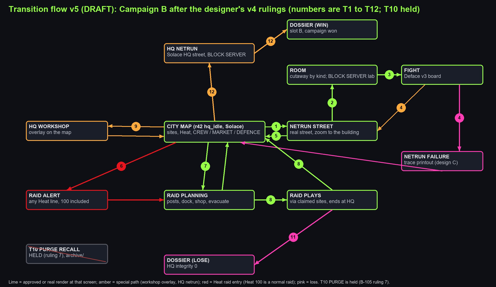

## T1  City map to netrun: pick a site, jack in, zoom to the exact building on its real street

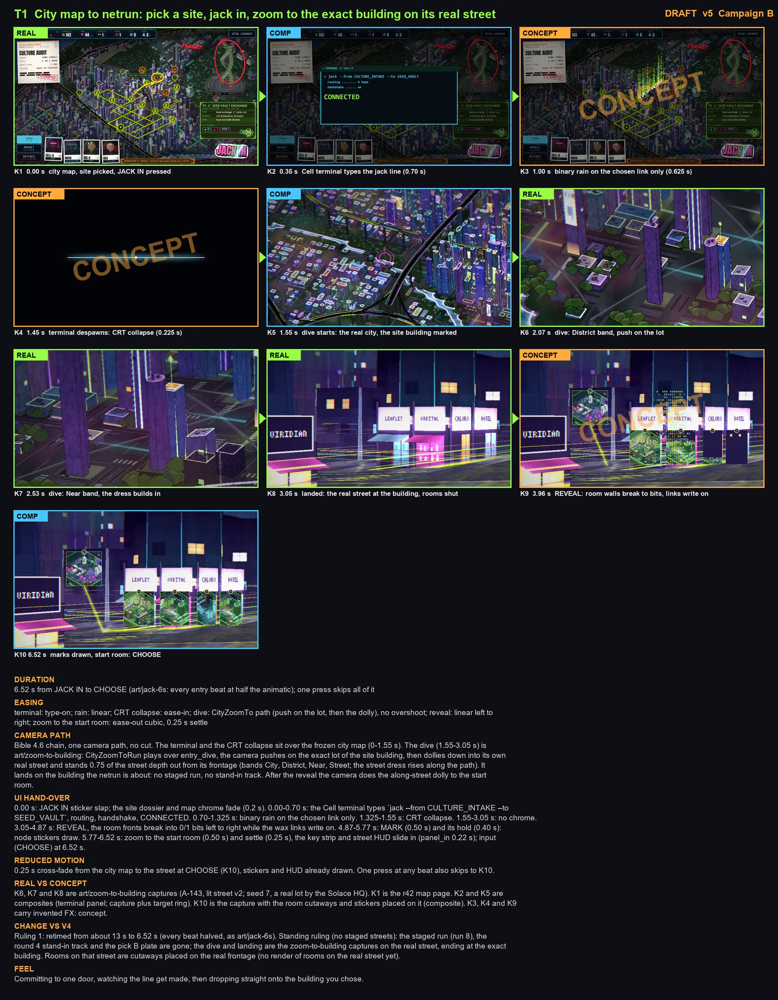

- **Keys:** K1  0.00 s  city map, site picked, JACK IN pressed [real]; K2  0.35 s  Cell terminal types the jack line (0.70 s) [comp]; K3  1.00 s  binary rain on the chosen link only (0.625 s) [concept]; K4  1.45 s  terminal despawns: CRT collapse (0.225 s) [concept]; K5  1.55 s  dive starts: the real city, the site building marked [comp]; K6  2.07 s  dive: District band, push on the lot [real]; K7  2.53 s  dive: Near band, the dress builds in [real]; K8  3.05 s  landed: the real street at the building, rooms shut [real]; K9  3.96 s  REVEAL: room walls break to bits, links write on [concept]; K10 6.52 s  marks drawn, start room: CHOOSE [comp]
- **Duration:** 6.52 s from JACK IN to CHOOSE (art/jack-6s: every entry beat at half the animatic); one press skips all of it
- **Easing:** terminal: type-on; rain: linear; CRT collapse: ease-in; dive: CityZoomTo path (push on the lot, then the dolly), no overshoot; reveal: linear left to right; zoom to the start room: ease-out cubic, 0.25 s settle
- **Camera path:** Bible 4.6 chain, one camera path, no cut. The terminal and the CRT collapse sit over the frozen city map (0-1.55 s). The dive (1.55-3.05 s) is art/zoom-to-building: CityZoomToRun plays over entry_dive, the camera pushes on the exact lot of the site building, then dollies down into its own real street and stands 0.75 of the street depth out from its frontage (bands City, District, Near, Street; the street dress rises along the path). It lands on the building the netrun is about: no staged run, no stand-in track. After the reveal the camera does the along-street dolly to the start room.
- **UI hand-over:** 0.00 s: JACK IN sticker slap; the site dossier and map chrome fade (0.2 s). 0.00-0.70 s: the Cell terminal types `jack --from CULTURE_INTAKE --to SEED_VAULT`, routing, handshake, CONNECTED. 0.70-1.325 s: binary rain on the chosen link only. 1.325-1.55 s: CRT collapse. 1.55-3.05 s: no chrome. 3.05-4.87 s: REVEAL, the room fronts break into 0/1 bits left to right while the wax links write on. 4.87-5.77 s: MARK (0.50 s) and its hold (0.40 s): node stickers draw. 5.77-6.52 s: zoom to the start room (0.50 s) and settle (0.25 s), the key strip and street HUD slide in (panel_in 0.22 s); input (CHOOSE) at 6.52 s.
- **Reduced motion:** 0.25 s cross-fade from the city map to the street at CHOOSE (K10), stickers and HUD already drawn. One press at any beat also skips to K10.
- **Feel:** Committing to one door, watching the line get made, then dropping straight onto the building you chose.
- **Real vs concept:** K6, K7 and K8 are art/zoom-to-building captures (A-143, lit street v2; seed 7, a real lot by the Solace HQ). K1 is the r42 map page. K2 and K5 are composites (terminal panel; capture plus target ring). K10 is the capture with the room cutaways and stickers placed on it (composite). K3, K4 and K9 carry invented FX: concept.
- **Change vs v4:** Ruling 1: retimed from about 13 s to 6.52 s (every beat halved, as art/jack-6s). Standing ruling (no staged streets): the staged run (run 8), the round 4 stand-in track and the pick B plate are gone; the dive and landing are the zoom-to-building captures on the real street, ending at the exact building. Rooms on that street are cutaways placed on the real frontage (no render of rooms on the real street yet).

## T2  Street to room: one seamless move in on our room, the other rooms close, then the cutaway pose

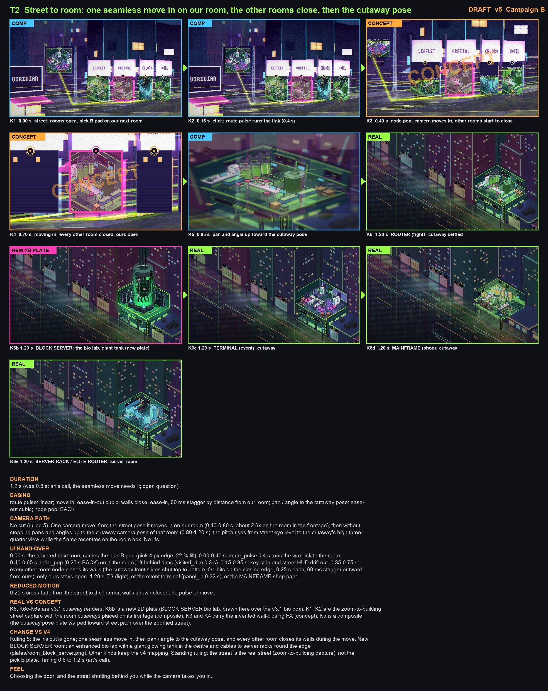

- **Keys:** K1  0.00 s  street: rooms open, pick B pad on our next room [comp]; K2  0.15 s  click: route pulse runs the link (0.4 s) [comp]; K3  0.40 s  node pop; camera moves in, other rooms start to close [concept]; K4  0.70 s  moving in: every other room closed, ours open [concept]; K5  0.95 s  pan and angle up toward the cutaway pose [comp]; K6  1.20 s  ROUTER (fight): cutaway settled [real]; K6b 1.20 s  BLOCK SERVER: the bio lab, giant tank (new plate) [new 2d plate]; K6c 1.20 s  TERMINAL (event): cutaway [real]; K6d 1.20 s  MAINFRAME (shop): cutaway [real]; K6e 1.20 s  SERVER RACK / ELITE ROUTER: server room [real]
- **Duration:** 1.2 s (was 0.8 s: art's call, the seamless move needs it; open question)
- **Easing:** route pulse: linear; move in: ease-in-out cubic; walls close: ease-in, 60 ms stagger by distance from our room; pan / angle to the cutaway pose: ease-out cubic; node pop: BACK
- **Camera path:** No cut (ruling 5). One camera move: from the street pose it moves in on our room (0.40-0.80 s, about 2.6x on the room in the frontage), then without stopping pans and angles up to the cutaway camera pose of that room (0.80-1.20 s): the pitch rises from street eye level to the cutaway's high three-quarter view while the frame recentres on the room box. No iris.
- **UI hand-over:** 0.00 s: the hovered next room carries the pick B pad (pink 4 px edge, 22 % fill). 0.00-0.40 s: route_pulse 0.4 s runs the wax link to the room; 0.40-0.65 s node_pop (0.25 s BACK) on it; the room left behind dims (visited_dim 0.3 s). 0.15-0.35 s: key strip and street HUD drift out. 0.35-0.75 s: every other room node closes its walls (the cutaway front slides shut top to bottom, 0/1 bits on the closing edge, 0.25 s each, 60 ms stagger outward from ours); only ours stays open. 1.20 s: T3 (fight), or the event terminal (panel_in 0.22 s), or the MAINFRAME shop panel.
- **Reduced motion:** 0.25 s cross-fade from the street to the interior; walls shown closed, no pulse or move.
- **Feel:** Choosing the door, and the street shutting behind you while the camera takes you in.
- **Real vs concept:** K6, K6c-K6e are v3.1 cutaway renders. K6b is a new 2D plate (BLOCK SERVER bio lab, drawn here over the v3.1 bio box). K1, K2 are the zoom-to-building street capture with the room cutaways placed on its frontage (composite). K3 and K4 carry the invented wall-closing FX (concept); K5 is a composite (the cutaway pose plate warped toward street pitch over the zoomed street).
- **Change vs v4:** Ruling 5: the iris cut is gone; one seamless move in, then pan / angle to the cutaway pose, and every other room closes its walls during the move. New BLOCK SERVER room: an enhanced bio lab with a giant glowing tank in the centre and cables to server racks round the edge (plates/room_block_server.png). Other kinds keep the v4 mapping. Standing ruling: the street is the real street (zoom-to-building capture), not the pick B plate. Timing 0.8 to 1.2 s (art's call).

## T3  Room to fight: the bits fly first and build the ring as they land, then the Deface v3 board

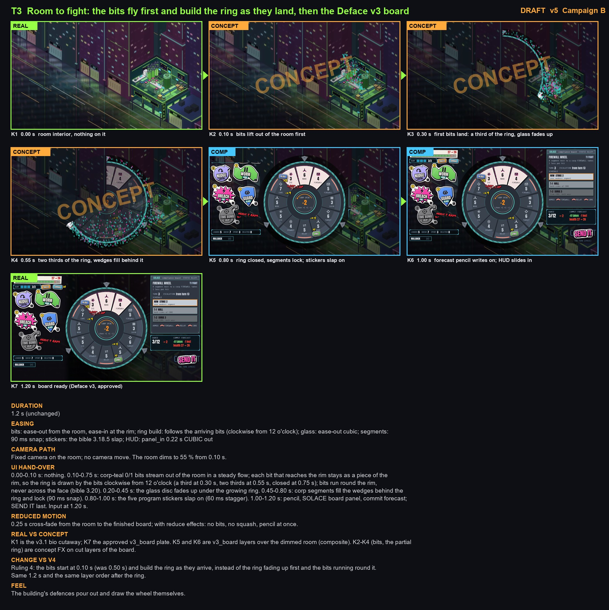

- **Keys:** K1  0.00 s  room interior, nothing on it [real]; K2  0.10 s  bits lift out of the room first [concept]; K3  0.30 s  first bits land: a third of the ring, glass fades up [concept]; K4  0.55 s  two thirds of the ring, wedges fill behind it [concept]; K5  0.80 s  ring closed, segments lock; stickers slap on [comp]; K6  1.00 s  forecast pencil writes on; HUD slides in [comp]; K7  1.20 s  board ready (Deface v3, approved) [real]
- **Duration:** 1.2 s (unchanged)
- **Easing:** bits: ease-out from the room, ease-in at the rim; ring build: follows the arriving bits (clockwise from 12 o'clock); glass: ease-out cubic; segments: 90 ms snap; stickers: the bible 3.18.5 slap; HUD: panel_in 0.22 s CUBIC out
- **Camera path:** Fixed camera on the room; no camera move. The room dims to 55 % from 0.10 s.
- **UI hand-over:** 0.00-0.10 s: nothing. 0.10-0.75 s: corp-teal 0/1 bits stream out of the room in a steady flow; each bit that reaches the rim stays as a piece of the rim, so the ring is drawn by the bits clockwise from 12 o'clock (a third at 0.30 s, two thirds at 0.55 s, closed at 0.75 s); bits run round the rim, never across the face (bible 3.20). 0.20-0.45 s: the glass disc fades up under the growing ring. 0.45-0.80 s: corp segments fill the wedges behind the ring and lock (90 ms snap). 0.80-1.00 s: the five program stickers slap on (60 ms stagger). 1.00-1.20 s: pencil, SOLACE board panel, commit forecast; SEND IT last. Input at 1.20 s.
- **Reduced motion:** 0.25 s cross-fade from the room to the finished board; with reduce effects: no bits, no squash, pencil at once.
- **Feel:** The building's defences pour out and draw the wheel themselves.
- **Real vs concept:** K1 is the v3.1 bio cutaway; K7 the approved v3_board plate. K5 and K6 are v3_board layers over the dimmed room (composite). K2-K4 (bits, the partial ring) are concept FX on cut layers of the board.
- **Change vs v4:** Ruling 4: the bits start at 0.10 s (was 0.50 s) and build the ring as they arrive, instead of the ring fading up first and the bits running round it. Same 1.2 s and the same layer order after the ring.

## T4  Fight ends: the board dissolves back to the street, or the runner falls (trace printout)

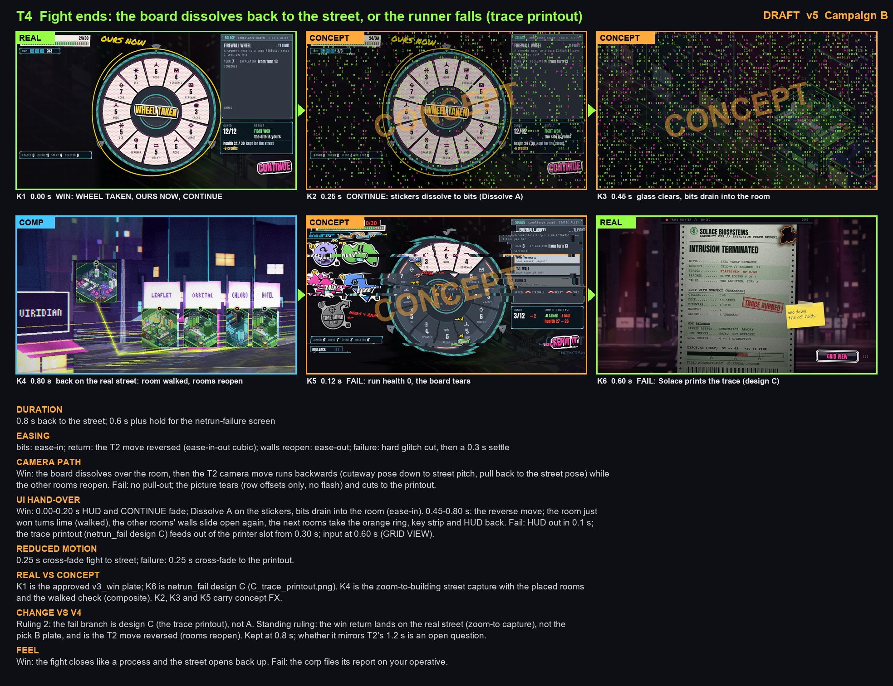

- **Keys:** K1  0.00 s  WIN: WHEEL TAKEN, OURS NOW, CONTINUE [real]; K2  0.25 s  CONTINUE: stickers dissolve to bits (Dissolve A) [concept]; K3  0.45 s  glass clears, bits drain into the room [concept]; K4  0.80 s  back on the real street: room walked, rooms reopen [comp]; K5  0.12 s  FAIL: run health 0, the board tears [concept]; K6  0.60 s  FAIL: Solace prints the trace (design C) [real]
- **Duration:** 0.8 s back to the street; 0.6 s plus hold for the netrun-failure screen
- **Easing:** bits: ease-in; return: the T2 move reversed (ease-in-out cubic); walls reopen: ease-out; failure: hard glitch cut, then a 0.3 s settle
- **Camera path:** Win: the board dissolves over the room, then the T2 camera move runs backwards (cutaway pose down to street pitch, pull back to the street pose) while the other rooms reopen. Fail: no pull-out; the picture tears (row offsets only, no flash) and cuts to the printout.
- **UI hand-over:** Win: 0.00-0.20 s HUD and CONTINUE fade; Dissolve A on the stickers, bits drain into the room (ease-in). 0.45-0.80 s: the reverse move; the room just won turns lime (walked), the other rooms' walls slide open again, the next rooms take the orange ring, key strip and HUD back. Fail: HUD out in 0.1 s; the trace printout (netrun_fail design C) feeds out of the printer slot from 0.30 s; input at 0.60 s (GRID VIEW).
- **Reduced motion:** 0.25 s cross-fade fight to street; failure: 0.25 s cross-fade to the printout.
- **Feel:** Win: the fight closes like a process and the street opens back up. Fail: the corp files its report on your operative.
- **Real vs concept:** K1 is the approved v3_win plate; K6 is netrun_fail design C (C_trace_printout.png). K4 is the zoom-to-building street capture with the placed rooms and the walked check (composite). K2, K3 and K5 carry concept FX.
- **Change vs v4:** Ruling 2: the fail branch is design C (the trace printout), not A. Standing ruling: the win return lands on the real street (zoom-to capture), not the pick B plate, and is the T2 move reversed (rooms reopen). Kept at 0.8 s; whether it mirrors T2's 1.2 s is an open question.

## T5  Street end, back up to the city map: the claimed site changes, then the advance choice

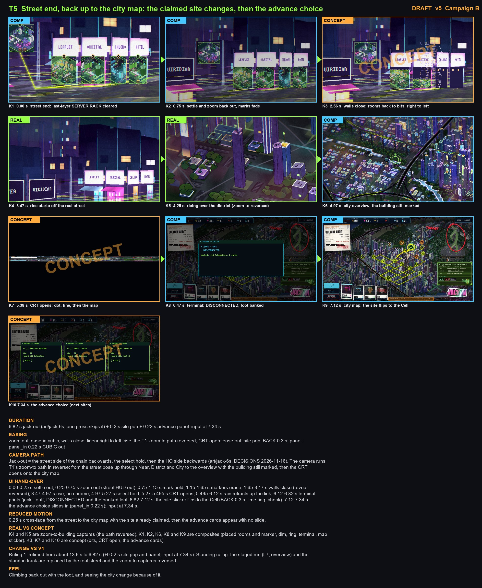

- **Keys:** K1  0.00 s  street end: last-layer SERVER RACK cleared [comp]; K2  0.75 s  settle and zoom back out, marks fade [comp]; K3  2.56 s  walls close: rooms back to bits, right to left [concept]; K4  3.47 s  rise starts off the real street [real]; K5  4.25 s  rising over the district (zoom-to reversed) [real]; K6  4.97 s  city overview, the building still marked [comp]; K7  5.38 s  CRT opens: dot, line, then the map [concept]; K8  6.47 s  terminal: DISCONNECTED, loot banked [comp]; K9  7.12 s  city map: the site flips to the Cell [comp]; K10 7.34 s  the advance choice (next sites) [concept]
- **Duration:** 6.82 s jack-out (art/jack-6s; one press skips it) + 0.3 s site pop + 0.22 s advance panel: input at 7.34 s
- **Easing:** zoom out: ease-in cubic; walls close: linear right to left; rise: the T1 zoom-to path reversed; CRT open: ease-out; site pop: BACK 0.3 s; panel: panel_in 0.22 s CUBIC out
- **Camera path:** Jack-out = the street side of the chain backwards, the select hold, then the HQ side backwards (art/jack-6s, DECISIONS 2026-11-16). The camera runs T1's zoom-to path in reverse: from the street pose up through Near, District and City to the overview with the building still marked, then the CRT opens onto the city map.
- **UI hand-over:** 0.00-0.25 s settle out; 0.25-0.75 s zoom out (street HUD out); 0.75-1.15 s mark hold, 1.15-1.65 s markers erase; 1.65-3.47 s walls close (reveal reversed); 3.47-4.97 s rise, no chrome; 4.97-5.27 s select hold; 5.27-5.495 s CRT opens; 5.495-6.12 s rain retracts up the link; 6.12-6.82 s terminal prints `jack --out`, DISCONNECTED and the banked loot. 6.82-7.12 s: the site sticker flips to the Cell (BACK 0.3 s, lime ring, check). 7.12-7.34 s: the advance choice slides in (panel_in 0.22 s); input at 7.34 s.
- **Reduced motion:** 0.25 s cross-fade from the street to the city map with the site already claimed, then the advance cards appear with no slide.
- **Feel:** Climbing back out with the loot, and seeing the city change because of it.
- **Real vs concept:** K4 and K5 are zoom-to-building captures (the path reversed). K1, K2, K6, K8 and K9 are composites (placed rooms and marker, dim, ring, terminal, map sticker). K3, K7 and K10 are concept (bits, CRT open, the advance cards).
- **Change vs v4:** Ruling 1: retimed from about 13.6 s to 6.82 s (+0.52 s site pop and panel, input at 7.34 s). Standing ruling: the staged run (L7, overview) and the stand-in track are replaced by the real street and the zoom-to captures reversed.

## T6  Heat threshold crossed: raid alert, the intercepted work order (INCOMING), city zooms to raid zoom  (unchanged, copied from v4)

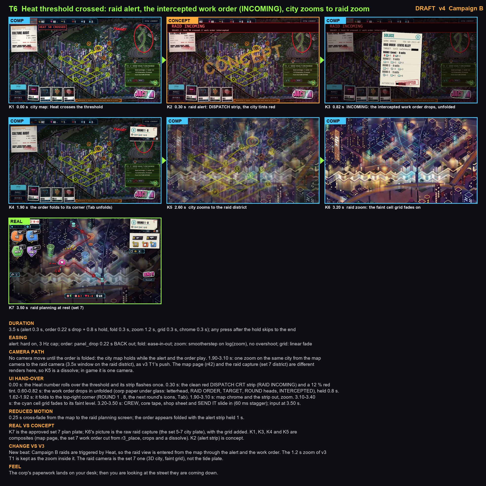

- **Keys:** K1  0.00 s  city map: Heat crosses the threshold [comp]; K2  0.30 s  raid alert: DISPATCH strip, the city tints red [concept]; K3  0.82 s  INCOMING: the intercepted work order drops, unfolded [comp]; K4  1.90 s  the order folds to its corner (Tab unfolds) [comp]; K5  2.60 s  city zooms to the raid district [comp]; K6  3.20 s  raid zoom: the faint cell grid fades on [comp]; K7  3.50 s  raid planning at rest (set 7) [real]
- **Duration:** 3.5 s (alert 0.3 s, order 0.22 s drop + 0.8 s hold, fold 0.3 s, zoom 1.2 s, grid 0.3 s, chrome 0.3 s); any press after the hold skips to the end
- **Easing:** alert: hard on, 3 Hz cap; order: panel_drop 0.22 s BACK out; fold: ease-in-out; zoom: smootherstep on log(zoom), no overshoot; grid: linear fade
- **Camera path:** No camera move until the order is folded: the city map holds while the alert and the order play. 1.90-3.10 s: one zoom on the same city from the map camera to the raid camera (3.5x window on the raid district), as v3 T1's push. The map page (r42) and the raid capture (set 7 district) are different renders here, so K5 is a dissolve; in game it is one camera.
- **UI hand-over:** 0.00 s: the Heat number rolls over the threshold and its strip flashes once. 0.30 s: the clean red DISPATCH CRT strip (RAID INCOMING) and a 12 % red tint. 0.60-0.82 s: the work order drops in unfolded (corp paper under glass: letterhead, RAID ORDER, TARGET, ROUND heads, INTERCEPTED), held 0.8 s. 1.62-1.92 s: it folds to the top-right corner (ROUND 1 . 8, the next round's icons, Tab). 1.90-3.10 s: map chrome and the strip out, zoom. 3.10-3.40 s: the cyan cell grid fades to its faint level. 3.20-3.50 s: CREW, core tape, shop sheet and SEND IT slide in (60 ms stagger); input at 3.50 s.
- **Reduced motion:** 0.25 s cross-fade from the map to the raid planning screen; the order appears folded with the alert strip held 1 s.
- **Feel:** The corp's paperwork lands on your desk; then you are looking at the street they are coming down.
- **Real vs concept:** K7 is the approved set 7 plan plate; K6's picture is the raw raid capture (the set 5-7 city plate), with the grid added. K1, K3, K4 and K5 are composites (map page, the set 7 work order cut from r3_place, crops and a dissolve). K2 (alert strip) is concept.
- **Change vs v4:** New beat: Campaign B raids are triggered by Heat, so the raid view is entered from the map through the alert and the work order. The 1.2 s zoom of v3 T1 is kept as the zoom inside it. The raid camera is the set 7 one (3D city, faint grid), not the tide plate. v5: unchanged. Ruling 7: Heat 100 opens this same alert (a normal raid, only stronger); no PURGE event.

## T7  Raid planning (slots, evacuate, dock / deploy, shop) and back to the map  (unchanged, copied from v4)

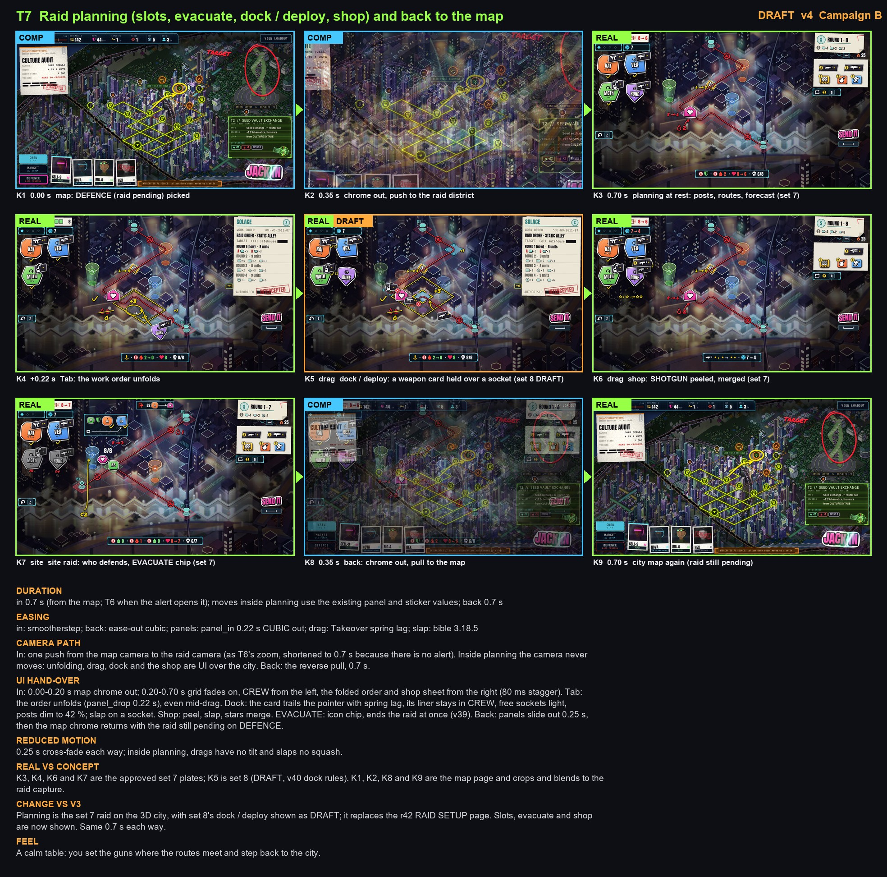

- **Keys:** K1  0.00 s  map: DEFENCE (raid pending) picked [comp]; K2  0.35 s  chrome out, push to the raid district [comp]; K3  0.70 s  planning at rest: posts, routes, forecast (set 7) [real]; K4  +0.22 s  Tab: the work order unfolds [real]; K5  drag  dock / deploy: a weapon card held over a socket (set 8 DRAFT) [real draft]; K6  drag  shop: SHOTGUN peeled, merged (set 7) [real]; K7  site  site raid: who defends, EVACUATE chip (set 7) [real]; K8  0.35 s  back: chrome out, pull to the map [comp]; K9  0.70 s  city map again (raid still pending) [real]
- **Duration:** in 0.7 s (from the map; T6 when the alert opens it); moves inside planning use the existing panel and sticker values; back 0.7 s
- **Easing:** in: smootherstep; back: ease-out cubic; panels: panel_in 0.22 s CUBIC out; drag: Takeover spring lag; slap: bible 3.18.5
- **Camera path:** In: one push from the map camera to the raid camera (as T6's zoom, shortened to 0.7 s because there is no alert). Inside planning the camera never moves: unfolding, drag, dock and the shop are UI over the city. Back: the reverse pull, 0.7 s.
- **UI hand-over:** In: 0.00-0.20 s map chrome out; 0.20-0.70 s grid fades on, CREW from the left, the folded order and shop sheet from the right (80 ms stagger). Tab: the order unfolds (panel_drop 0.22 s), even mid-drag. Dock: the card trails the pointer with spring lag, its liner stays in CREW, free sockets light, posts dim to 42 %; slap on a socket. Shop: peel, slap, stars merge. EVACUATE: icon chip, ends the raid at once (v39). Back: panels slide out 0.25 s, then the map chrome returns with the raid still pending on DEFENCE.
- **Reduced motion:** 0.25 s cross-fade each way; inside planning, drags have no tilt and slaps no squash.
- **Feel:** A calm table: you set the guns where the routes meet and step back to the city.
- **Real vs concept:** K3, K4, K6 and K7 are the approved set 7 plates; K5 is set 8 (DRAFT, v40 dock rules). K1, K2, K8 and K9 are the map page and crops and blends to the raid capture.
- **Change vs v4:** Planning is the set 7 raid on the 3D city, with set 8's dock / deploy shown as DRAFT; it replaces the r42 RAID SETUP page. Slots, evacuate and shop are now shown. Same 0.7 s each way. v5: unchanged.

## T8  Raid plays on the city, then the result, back to the map (site held or lost, HQ damage)  (unchanged, copied from v4)

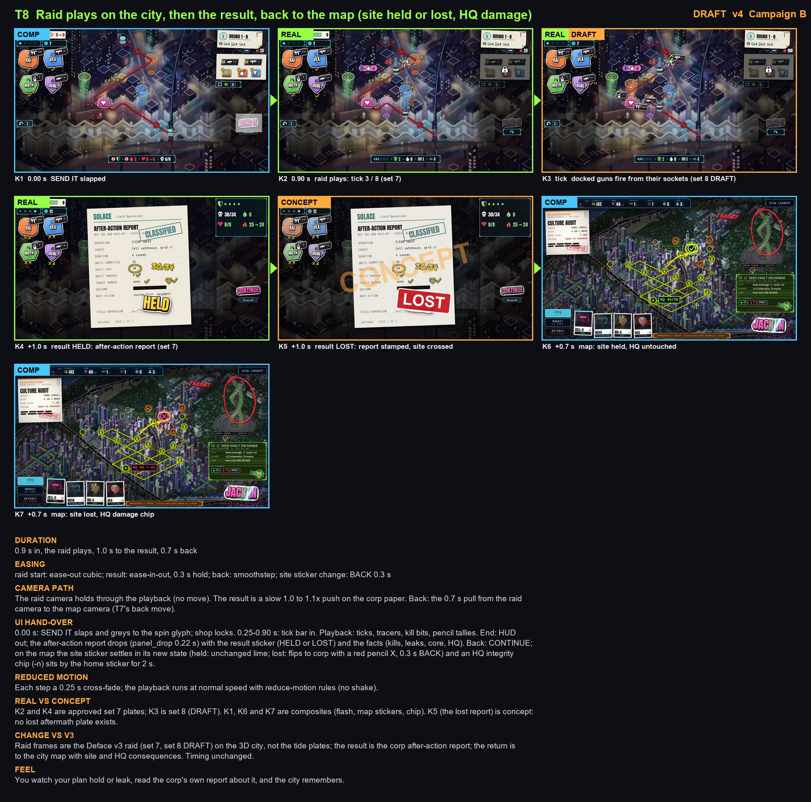

- **Keys:** K1  0.00 s  SEND IT slapped [comp]; K2  0.90 s  raid plays: tick 3 / 8 (set 7) [real]; K3  tick  docked guns fire from their sockets (set 8 DRAFT) [real draft]; K4  +1.0 s  result HELD: after-action report (set 7) [real]; K5  +1.0 s  result LOST: report stamped, site crossed [concept]; K6  +0.7 s  map: site held, HQ untouched [comp]; K7  +0.7 s  map: site lost, HQ damage chip [comp]
- **Duration:** 0.9 s in, the raid plays, 1.0 s to the result, 0.7 s back
- **Easing:** raid start: ease-out cubic; result: ease-in-out, 0.3 s hold; back: smoothstep; site sticker change: BACK 0.3 s
- **Camera path:** The raid camera holds through the playback (no move). The result is a slow 1.0 to 1.1x push on the corp paper. Back: the 0.7 s pull from the raid camera to the map camera (T7's back move).
- **UI hand-over:** 0.00 s: SEND IT slaps and greys to the spin glyph; shop locks. 0.25-0.90 s: tick bar in. Playback: ticks, tracers, kill bits, pencil tallies. End: HUD out; the after-action report drops (panel_drop 0.22 s) with the result sticker (HELD or LOST) and the facts (kills, leaks, core, HQ). Back: CONTINUE; on the map the site sticker settles in its new state (held: unchanged lime; lost: flips to corp with a red pencil X, 0.3 s BACK) and an HQ integrity chip (-n) sits by the home sticker for 2 s.
- **Reduced motion:** Each step a 0.25 s cross-fade; the playback runs at normal speed with reduce-motion rules (no shake).
- **Feel:** You watch your plan hold or leak, read the corp's own report about it, and the city remembers.
- **Real vs concept:** K2 and K4 are approved set 7 plates; K3 is set 8 (DRAFT). K1, K6 and K7 are composites (flash, map stickers, chip). K5 (the lost report) is concept: no lost aftermath plate exists.
- **Change vs v4:** Raid frames are the Deface v3 raid (set 7, set 8 DRAFT) on the 3D city, not the tide plates; the result is the corp after-action report; the return is to the city map with site and HQ consequences. Timing unchanged. v5: unchanged; approved (ruling 8). Under v47 every raid routes through claimed sites and ends at our HQ, so the HQ chip (K7) can follow any raid.

## T9  HQ workshop: an overlay on the city map (recruit, weapons, talents) and back

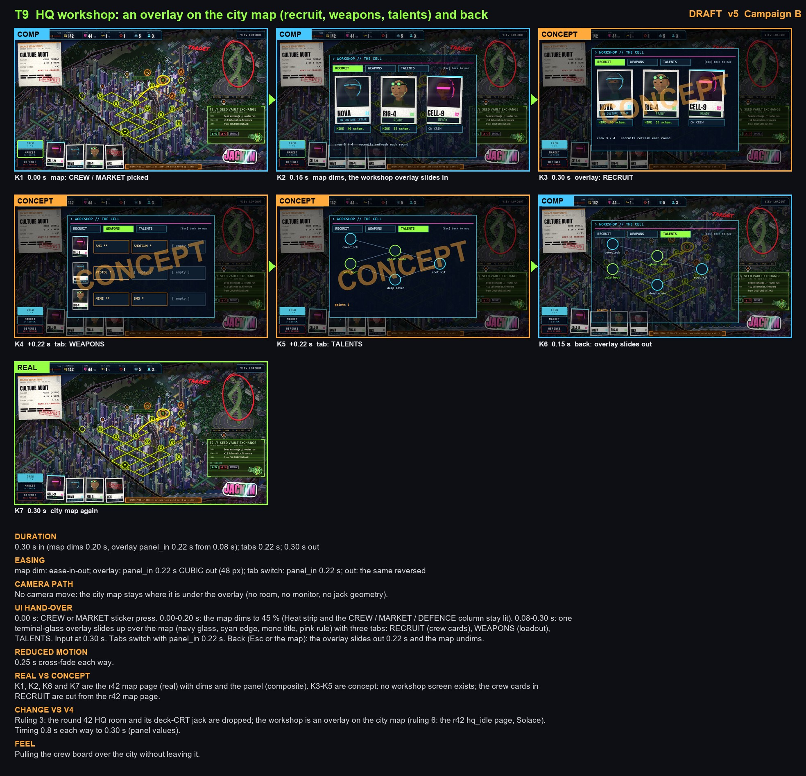

- **Keys:** K1  0.00 s  map: CREW / MARKET picked [comp]; K2  0.15 s  map dims, the workshop overlay slides in [comp]; K3  0.30 s  overlay: RECRUIT [concept]; K4  +0.22 s  tab: WEAPONS [concept]; K5  +0.22 s  tab: TALENTS [concept]; K6  0.15 s  back: overlay slides out [comp]; K7  0.30 s  city map again [real]
- **Duration:** 0.30 s in (map dims 0.20 s, overlay panel_in 0.22 s from 0.08 s); tabs 0.22 s; 0.30 s out
- **Easing:** map dim: ease-in-out; overlay: panel_in 0.22 s CUBIC out (48 px); tab switch: panel_in 0.22 s; out: the same reversed
- **Camera path:** No camera move: the city map stays where it is under the overlay (no room, no monitor, no jack geometry).
- **UI hand-over:** 0.00 s: CREW or MARKET sticker press. 0.00-0.20 s: the map dims to 45 % (Heat strip and the CREW / MARKET / DEFENCE column stay lit). 0.08-0.30 s: one terminal-glass overlay slides up over the map (navy glass, cyan edge, mono title, pink rule) with three tabs: RECRUIT (crew cards), WEAPONS (loadout), TALENTS. Input at 0.30 s. Tabs switch with panel_in 0.22 s. Back (Esc or the map): the overlay slides out 0.22 s and the map undims.
- **Reduced motion:** 0.25 s cross-fade each way.
- **Feel:** Pulling the crew board over the city without leaving it.
- **Real vs concept:** K1, K2, K6 and K7 are the r42 map page (real) with dims and the panel (composite). K3-K5 are concept: no workshop screen exists; the crew cards in RECRUIT are cut from the r42 map page.
- **Change vs v4:** Ruling 3: the round 42 HQ room and its deck-CRT jack are dropped; the workshop is an overlay on the city map (ruling 6: the r42 hq_idle page, Solace). Timing 0.8 s each way to 0.30 s (panel values).

## T10  PURGE recall: HELD

T10 (PURGE recall at Heat 100) is HELD / withdrawn (ruling 7): PURGE is dropped as a special event; Heat 100 is a normal raid through T6, T7 and T8, only stronger. The recall-streak FX is held (not deleted). The v4 sheet is kept in `archive/t10_purge_recall_HELD.jpg`, stamped HELD.

## T11  HQ integrity 0: the dossier folder, campaign lost

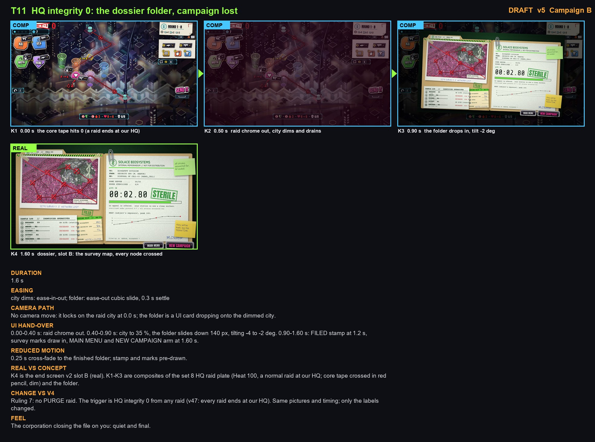

- **Keys:** K1  0.00 s  the core tape hits 0 (a raid ends at our HQ) [comp]; K2  0.50 s  raid chrome out, city dims and drains [comp]; K3  0.90 s  the folder drops in, tilt -2 deg [comp]; K4  1.60 s  dossier, slot B: the survey map, every node crossed [real]
- **Duration:** 1.6 s
- **Easing:** city dims: ease-in-out; folder: ease-out cubic slide, 0.3 s settle
- **Camera path:** No camera move: it locks on the raid city at 0.0 s; the folder is a UI card dropping onto the dimmed city.
- **UI hand-over:** 0.00-0.40 s: raid chrome out. 0.40-0.90 s: city to 35 %, the folder slides down 140 px, tilting -4 to -2 deg. 0.90-1.60 s: FILED stamp at 1.2 s, survey marks draw in, MAIN MENU and NEW CAMPAIGN arm at 1.60 s.
- **Reduced motion:** 0.25 s cross-fade to the finished folder; stamp and marks pre-drawn.
- **Feel:** The corporation closing the file on you: quiet and final.
- **Real vs concept:** K4 is the end screen v2 slot B (real). K1-K3 are composites of the set 8 HQ raid plate (Heat 100, a normal raid at our HQ; core tape crossed in red pencil, dim) and the folder.
- **Change vs v4:** Ruling 7: no PURGE raid. The trigger is HQ integrity 0 from any raid (v47: every raid ends at our HQ). Same pictures and timing; only the labels changed.

## T12  Tier 3 sites taken: fly in on the Solace HQ street (real city), BLOCK SERVER, the win and the dossier

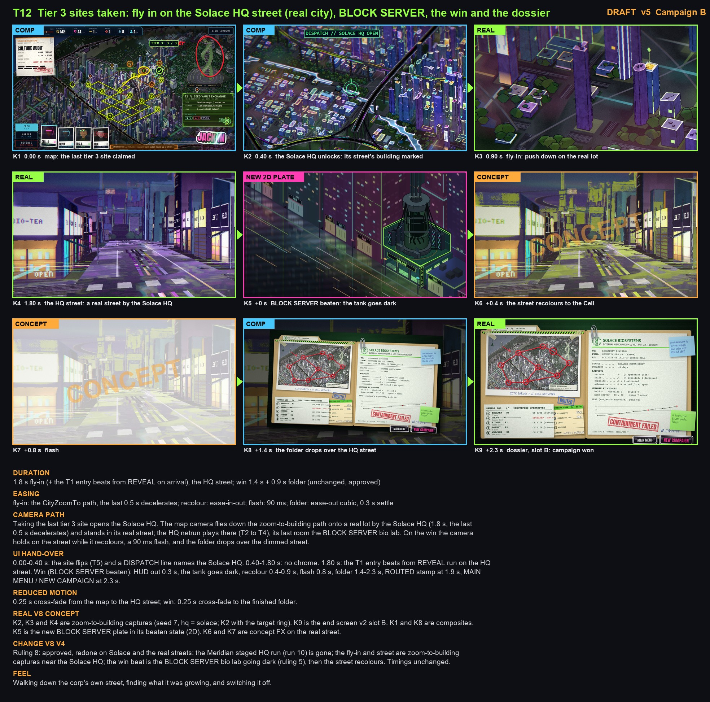

- **Keys:** K1  0.00 s  map: the last tier 3 site claimed [comp]; K2  0.40 s  the Solace HQ unlocks: its street's building marked [comp]; K3  0.90 s  fly-in: push down on the real lot [real]; K4  1.80 s  the HQ street: a real street by the Solace HQ [real]; K5  +0 s  BLOCK SERVER beaten: the tank goes dark [new 2d plate]; K6  +0.4 s  the street recolours to the Cell [concept]; K7  +0.8 s  flash [concept]; K8  +1.4 s  the folder drops over the HQ street [comp]; K9  +2.3 s  dossier, slot B: campaign won [real]
- **Duration:** 1.8 s fly-in (+ the T1 entry beats from REVEAL on arrival), the HQ street; win 1.4 s + 0.9 s folder (unchanged, approved)
- **Easing:** fly-in: the CityZoomTo path, the last 0.5 s decelerates; recolour: ease-in-out; flash: 90 ms; folder: ease-out cubic, 0.3 s settle
- **Camera path:** Taking the last tier 3 site opens the Solace HQ. The map camera flies down the zoom-to-building path onto a real lot by the Solace HQ (1.8 s, the last 0.5 s decelerates) and stands in its real street; the HQ netrun plays there (T2 to T4), its last room the BLOCK SERVER bio lab. On the win the camera holds on the street while it recolours, a 90 ms flash, and the folder drops over the dimmed street.
- **UI hand-over:** 0.00-0.40 s: the site flips (T5) and a DISPATCH line names the Solace HQ. 0.40-1.80 s: no chrome. 1.80 s: the T1 entry beats from REVEAL run on the HQ street. Win (BLOCK SERVER beaten): HUD out 0.3 s, the tank goes dark, recolour 0.4-0.9 s, flash 0.8 s, folder 1.4-2.3 s, ROUTED stamp at 1.9 s, MAIN MENU / NEW CAMPAIGN at 2.3 s.
- **Reduced motion:** 0.25 s cross-fade from the map to the HQ street; win: 0.25 s cross-fade to the finished folder.
- **Feel:** Walking down the corp's own street, finding what it was growing, and switching it off.
- **Real vs concept:** K2, K3 and K4 are zoom-to-building captures (seed 7, hq = solace; K2 with the target ring). K9 is the end screen v2 slot B. K1 and K8 are composites. K5 is the new BLOCK SERVER plate in its beaten state (2D). K6 and K7 are concept FX on the real street.
- **Change vs v4:** Ruling 8: approved, redone on Solace and the real streets: the Meridian staged HQ run (run 10) is gone; the fly-in and street are zoom-to-building captures near the Solace HQ; the win beat is the BLOCK SERVER bio lab going dark (ruling 5), then the street recolours. Timings unchanged.

## The BLOCK SERVER room (ruling 5)

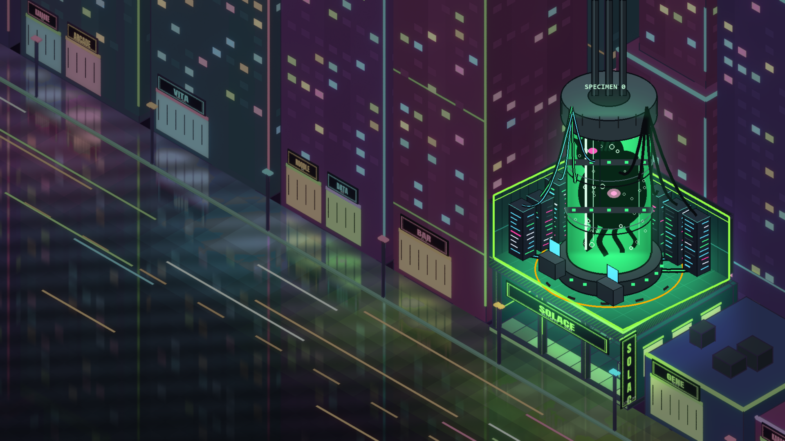

An enhanced bio lab: a giant glowing tank in the centre (corp_solace liquid, a dark curled specimen with one lit eye, bubbles, steel bands, a cap with pipes up out of the cutaway), cables from the tank to server racks along the back walls (floor runs and overhead sagging lines), two lab consoles facing the tank, an amber hazard ring. Drawn in 2D over the v3.1 bio cutaway box, so the building, street and SOLACE signage match the other rooms. `room_block_server_beaten.png` is the same room with the tank dark (T12 K5).

## Still concept (what the next pass would replace)

- **Entry and jack-out FX** (T1 K3, K4, K9; T5 K3, K7): binary rain, CRT collapse / open, the room fronts to bits.
- **Rooms on the real street** (T1 K9-K10, T2 K1-K4, T4 K4, T5 K1-K3): the zoom-to-building street has no rooms rendered yet (A-142: rooms show on landing, room lots pending from build). The cutaways here are v3.1 crops placed on the real frontage; the wall closing (T2) is drawn.
- **Cutaway pose surroundings** (T2 K6-K6e): the v3.1 room plates stand in their own kit street; in game the cutaway pose is on the real building.
- **BLOCK SERVER bio lab** (T2 K6b, T12 K5): a 2D plate; a cutaway kit render with a tank prop is the next step.
- **Board assembly** (T3 K2-K4): bits building the rim.
- **Raid alert** (T6 K2): the DISPATCH strip and the red tint.
- **Advance choice** (T5 K10) and the **workshop overlay** (T9 K3-K5): no screen exists.
- **Lost raid report** (T8 K5): no lost aftermath plate exists.
- **HQ win recolour** (T12 K6, K7): a hue shift on the real street.

## Calls I made (not designer rulings)

1. **T2 is 1.2 s** (was 0.8 s): a move in, a pan / angle and the walls closing do not read in 0.8 s. T4's win return stays 0.8 s.
2. **Walls close top to bottom with bits on the edge**, 0.25 s each, staggered outward from our room by 60 ms (the reveal's language reversed).
3. **T3 ring builds clockwise from 12 o'clock**, drawn by the bits that arrive (a third by 0.30 s, closed by 0.75 s).
4. **The workshop overlay** is one terminal-glass panel with three tabs over the dimmed map, 0.30 s in and out, panel values only.
5. **Real-street frames** are the A-143 lit captures (`D:/rc_tmp/claude/zt/final`, the frames of `zoom_to_building/zoom_strip.jpg`), copied to `plates/zoom_to/`; the older `D:/rc_scratch/zoom_to/` frames are the dark v1 street and were not used.
6. **The HQ street (T12)** is the capture at lot (-47, -55) next to the Solace HQ rect; the helix landmark is not in those frames, so the win beat is the BLOCK SERVER tank going dark plus a street recolour.
7. **BLOCK SERVER plate** is drawn in 2D over the v3.1 bio cutaway box (same geometry, street and SOLACE signage), Solace palette (corp_solace #3DFF8B, net_cyan #5CE1FF).

## Open questions for the designer

1. **T2 length:** 1.2 s for the seamless move (art's call). And should T4's win return mirror it (1.2 s) or stay 0.8 s?
2. **BLOCK SERVER bio lab:** is the plate the right direction (giant tank, a dark specimen with one lit eye, racks on the back walls, overhead and floor cables)? If yes, art builds it as a cutaway kit room.
3. **The specimen:** keep a silhouette that is never shown clearly, or show what Solace is growing?
4. **Workshop overlay:** one panel with tabs (drawn), or three separate cards by the CREW / MARKET buttons? Talents still have no screen.
5. **Advance choice** (T5 K10) and the **lost raid report** (T8 K5) are still open from v4.

## Build log

- Built by `scripts/build5.py` (with `helpers5.py`, a copy of v4 `helpers4.py`; `text5.py`, which reuses a verbatim copy of v4 `text4.py`; and `blocklab5.py`, the BLOCK SERVER plate), run as `python scripts/build5.py` from `transitions/v5/`. PIL and numpy only; no Godot, no Blender. v4 is untouched.
- Writes only into `transitions/v5/`. Unchanged strips (T6, T7, T8) are byte copies of the v4 files. `plates/PLATES.txt` lists every source with its md5 prefix.
- Iterations: room slots on the street were first placed from a scaled grid read and landed off the shopfronts (fixed to source pixels); room crops tightened; T12 recolour narrowed to the neon (the first pass tinted the whole street). Every sheet was looked at.
- Process slip (honest): one shell call carried a stray `python - 2>/dev/null` fragment; it was blocked by the permission check before it ran, nothing executed. Every build ran as `python scripts/<file>.py`, one process at a time, in the foreground.
- Jack timings are from art/jack-6s 980f31f1a (godot_look): ui_motion.tres beats at 0.5 of the animatic, select hold 0.3 s; jack-in 6.52 s, jack-out 6.82 s.
